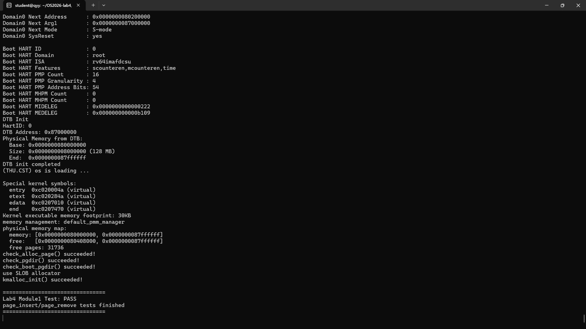

# 操作系统实验 Lab4 实验报告

> **实验主题**：物理页映射管理、进程创建与调度（RISC-V uCore）  
> **小组成员**：程浩轩 /徐子恩/胡家华
> **实验分工**：程浩轩负责**功能模块一：虚拟内存页映射操作**；  
> **项目/分支**：Lab4；

## 1. 实验目的

本实验是在之前物理内存管理与中断异常处理实验基础上，继续学习 uCore 内核的虚拟内存页表及进程管理机制。整个 Lab4 涉及虚拟地址和物理页之间的映射、进程创建，以及调度运行。本人负责第一部分，目标是实现 `kern/mm/pmm.c` 内的 `page_insert()` 和 `page_remove()`：使内核能够建立、替换、删除虚拟地址对应的物理页映射，并正确更新页表项、物理页引用计数及 TLB。随后利用框架的 `check_pgdir()` 和 `check_boot_pgdir()` 验证实现。

## 2. 实验环境与工具

| 项目 | 实际使用情况 |
|---|---|
| 主机环境 | Windows + WSL Ubuntu，终端用户为 `student` |
| 实验工程 | `~/OS2026-lab4/lab4_new` |
| 目标架构 | RISC-V 64 位，Sv39 三级页表 |
| 编译工具链 | `riscv64-unknown-elf-*` 交叉工具链，`make` |
| 运行环境 | QEMU `virt` 虚拟机，OpenSBI |
| 代码文件 | `kern/mm/pmm.c`、`kern/mm/default_pmm.c`、`kern/mm/memlayout.h` |
| 辅助工具 | Python 3（提取与恢复前置实验代码）、终端、ChatGPT（分析接口、错误与测试流程） |

## 3. 整体实验内容与小组分工

| 模块 | 主要任务 | 实现状态 |
|---|---|---|
| 功能模块一 程浩轩 | `page_insert`、`page_remove`；页表映射、引用计数、TLB 一致性 | **实现完成，已独立测试通过** |
| 功能模块二（其他成员） | 进程控制块初始化、内核线程创建及 `do_fork` 等 | 待小组合并，不在本报告中声明完成 |
| 功能模块三（其他成员） | 空闲进程、进程切换与调度相关函数 | 待小组合并，不在本报告中声明完成 |

## 4. 模块一相关基础原理

### 4.1 页表映射的含义

用户或内核访问一个虚拟地址时，处理器需要通过页表找到对应物理页。Sv39 采用三级页表，虚拟地址中的索引字段用于逐级定位页表项（PTE）。框架的 `get_pte(pgdir, la, create)` 已经负责找到 `la` 对应的叶子页表项；当 `create` 为真且中间页表不存在时，它会申请物理页存放新页表。本人实现的两个函数在叶子页表项上操作，而不是重复实现三级页表遍历。

### 4.2 页表项与权限

`pte_create(page2ppn(page), perm)` 使用物理页号和权限构造页表项，并设置有效位 `PTE_V`。本实验的权限标志涉及 `PTE_U`、`PTE_W`、`PTE_R` 等。建立或替换映射后，页表中必须记录新的物理页与相应权限；同一物理页重新插入时，也应允许更新权限。

### 4.3 物理页引用计数

一个物理页可以同时被多个虚拟页引用，因此不能一删除映射就释放物理页。`page_ref_inc(page)` 在增加映射引用时加一；`page_ref_dec(page)` 在撤销映射引用时减一；只有引用计数降到零，才通过 `free_page(page)` 归还物理页。若新的映射目标就是原物理页，则只需要更新 PTE，引用计数保持原值。

### 4.4 TLB 同步

CPU 可能保存旧的虚拟地址转换结果。修改有效 PTE 后需要使对应地址的旧 TLB 项失效。框架提供 `tlb_invalidate(pgdir, la)`，底层使用 `sfence.vma` 完成指定地址的转换缓存同步。

## 5. 功能模块一设计与实现

### 5.1 需要修改的位置

实验框架在 `kern/mm/pmm.c` 中保留了 `//LAB4 function1 YOUR CODE` 标记。根据任务要求，本人仅在此标记下新增页映射操作函数，未覆盖 `get_pte()`、`get_page()` 或老师提供的 `check_pgdir()`、`check_boot_pgdir()`。

主要接口：

```c
int page_insert(pde_t *pgdir, struct Page *page,
                uintptr_t la, uint32_t perm);
void page_remove(pde_t *pgdir, uintptr_t la);
```

### 5.2 `page_insert()` 实现思路

1. `get_pte(pgdir, la, 1)` 获取叶子页表项；若申请中间页表失败，返回 `-E_NO_MEM`。
2. 为新物理页增加引用计数。
3. 如果原 PTE 已有效，使用 `pte2page(*ptep)` 找到旧物理页：
   - 原物理页与目标物理页相同，抵消刚增加的引用计数，避免重复计数；
   - 如果是不同物理页，先撤销旧映射并减少旧页引用计数，归零时释放旧页。
4. 使用 `pte_create(page2ppn(page), perm)` 写入新的有效叶子 PTE。
5. 执行 `tlb_invalidate(pgdir, la)`，返回零。

```c
pte_t *ptep = get_pte(pgdir, la, 1);
if (ptep == NULL) {
    return -E_NO_MEM;
}
page_ref_inc(page);
if (*ptep & PTE_V) {
    struct Page *old_page = pte2page(*ptep);
    if (old_page == page) {
        page_ref_dec(page);
    } else {
        *ptep = 0;
        if (page_ref_dec(old_page) == 0) {
            free_page(old_page);
        }
    }
}
*ptep = pte_create(page2ppn(page), perm);
tlb_invalidate(pgdir, la);
return 0;
```

### 5.3 `page_remove()` 实现思路

1. 以 `create=0` 调用 `get_pte()`，不为删除操作分配新页表。
2. 若页表项不存在或没有 `PTE_V`，直接返回。
3. 找到原物理页，清除 PTE；引用计数减一，降至零时释放物理页。
4. 调用 `tlb_invalidate()`，让后续访问不能继续使用旧映射。

```c
pte_t *ptep = get_pte(pgdir, la, 0);
if (ptep == NULL || !(*ptep & PTE_V)) {
    return;
}
struct Page *page = pte2page(*ptep);
*ptep = 0;
if (page_ref_dec(page) == 0) {
    free_page(page);
}
tlb_invalidate(pgdir, la);
```

### 5.4 关键接口之间的关系

| 接口 | 在模块一中的作用 |
|---|---|
| `get_pte()` | 查找叶子 PTE，必要时创建中间页表 |
| `pte2page()` | 由有效 PTE 找到对应的 `Page` 描述符 |
| `page2ppn()` / `pte_create()` | 将目标物理页写为有效 PTE |
| `page_ref_inc()` / `page_ref_dec()` | 跟踪物理页映射引用 |
| `free_page()` | 归还已无映射引用的物理页 |
| `tlb_invalidate()` | 同步页表变更与处理器地址转换缓存 |

## 6. 前置代码补全、问题分析与修复

### 6.1 编译时缺少 `best_fit_pmm.h`

初次执行 `make clean && make` 时，编译 `kern/mm/default_pmm.c` 报出 `best_fit_pmm.h: No such file or directory`。检查发现 Lab4 原始工程缺少该头文件，而已完成的 Lab2 工程 `~/nku-os-2026-lab/kern/mm/` 中存在。将该头文件复制到 Lab4 的 `kern/mm/`，解决了第一处头文件缺失。

### 6.2 Default PMM 的状态及方法缺失

继续编译出现 `free_list`、`nr_free` 未定义。对比 Lab2 和 Lab4 后发现，Lab4 的 `default_pmm.c` 保留了老师的 `basic_check()`、`best_fit_check()`，但缺少实际的 First-Fit 内存分配器实现。于是从 Lab2 恢复 `free_area`、相关宏以及 `default_init()`、`default_init_memmap()`、`default_alloc_pages()`、`default_free_pages()`、`default_nr_free_pages()`，补充 `default_pmm_manager` 注册，并将 Default PMM 的 `.check` 指向 `basic_check()`。保留 Lab4 原有的两段测试内容不变。

### 6.3 `page_init()` 缺失

执行 `make -k` 时，`pmm.c` 出现 `page_init()` 隐式声明警告。恢复 Lab2 中已验证的 `page_init()` 实现，并为当前 `memlayout.h` 补充实验使用的 `PHYSICAL_MEMORY_END = 0x88000000`、`KERNEL_BEGIN_PADDR = 0x80200000`，保留 Lab4 原有的 `PHYSICAL_MEMORY_OFFSET`、三级页表与模块一代码。

### 6.4 链接缺少进程与调度接口

完成前置代码补全后，全部 C 文件能够编译，但链接时报：

```text
undefined reference to `proc_init'
undefined reference to `cpu_idle'
```

这两个函数分别属于尚未合并的进程初始化和调度模块，不是模块一的页映射代码错误。为验证模块一，临时备份并修改 `kern/init/init.c`，让启动流程在 `pmm_init()` 返回后打印模块一测试标志并进入空循环，暂不进入 `proc_init()`、`cpu_idle()` 等未完成部分。同时备份并暂时将 Makefile 的 QEMU 启动方式从 `-device loader,file=$(UCOREIMG),addr=0x80200000` 改为 `-kernel $(UCOREIMG)`。

### 6.5 其他编译提示

`trap.c` 中 `interrupt_handler()`、`exception_handler()` 有隐式声明警告，`kmalloc.c` 中 `kva2page()` 存在指针参数类型警告。本次独立测试未因这些警告中断，但完整 Lab4 集成时仍应检查和修正，而不能视作已经解决。

## 7. 编译与测试过程

### 7.1 编译验证

在项目根目录执行：

```bash
cd ~/OS2026-lab4/lab4_new
make clean
make -k
```

恢复 Lab2 基础功能后，日志出现 `+ cc kern/mm/default_pmm.c`、`+ cc kern/mm/pmm.c`、`+ cc kern/mm/vmm.c`，证明相关 C 文件编译完成。首次完整链接因 `proc_init`、`cpu_idle` 缺失而失败；之后使用临时模块一独立测试启动入口，重新编译并启动 QEMU。

### 7.2 QEMU 独立运行

临时测试版本使用：

```bash
make clean
make
make qemu
```

QEMU 输出显示设备树解析了 128 MB 物理内存，初始化后空闲页数为 **31,736**，关键输出如下：

```text
Physical Memory from DTB:
    Base: 0x0000000080000000
    Size: 0x0000000008000000 (128 MB)
...
free pages: 31736
check_alloc_page() succeeded!
check_pgdir() succeeded!
check_boot_pgdir() succeeded!
use SLOB allocator
kmalloc_init() succeeded!

==============================
Lab4 Module1 Test: PASS
page_insert/page_remove tests finished
==============================
```

> 此处 `Lab4 Module1 Test: PASS` 为**临时测试入口在 `pmm_init()` 正常返回后打印的标识**，并不是额外一套自动评分程序；主要功能证据是框架自带的 `check_pgdir()` 与 `check_boot_pgdir()` 通过。



*图 1：2026-11-10 的 QEMU 运行截图。截图显示 `check_alloc_page()`、`check_pgdir()`、`check_boot_pgdir()` 和模块一测试结束标识。*

### 7.3 测试覆盖情况

| 测试点 | 实际依据 | 结果 |
|---|---|---|
| 基础物理页分配器 | `check_alloc_page()` | 通过 |
| 插入虚拟页映射及引用计数 | `check_pgdir()` 的断言 | 通过 |
| 替换映射、访问权限与删除操作 | `check_pgdir()` 的断言 | 通过 |
| 同一物理页映射到两个虚拟地址、地址访问一致性 | `check_boot_pgdir()` | 通过 |
| 内核小对象分配器初始化 | `kmalloc_init()` | 通过 |

## 8. AI 辅助记录与提示词整理

本实验使用 AI 主要辅助理解接口、定位编译依赖、设计独立验证流程。实际代码仍应以本地编译和 QEMU 运行结果为依据。以下是根据本次真实对话整理的代表性四段式提问示例；不是聊天原文的逐字备份。完整交互记录可按组内提交要求另存 `report/prompt.md`。

### 8.1 需求分析与函数设计

**[PROMPT]**：我负责 RISC-V uCore Lab4 的功能模块一，要求实现 `pmm.c` 中的 `page_insert()` 和 `page_remove()`。请结合框架实际提供的 `get_pte`、引用计数及 TLB 接口，分析映射插入、替换与删除的流程。

**[RELY]**：依据实验框架 `pmm.c` 的 `get_pte()`、`get_page()`、`check_pgdir()`、`check_boot_pgdir()`，以及 `pmm.h`、`mmu.h` 中的相关类型和宏。

**[GUARANTEE]**：不能覆盖已有页表代码或修改老师的测试；要防止同一物理页重复插入导致引用计数错误；无法申请页表时应返回 `-E_NO_MEM`。

**[SPECIFICATION]**：给出两个函数的实现流程、带注释的 C 代码及每个关键分支的作用，并提供检查命令。

### 8.2 编译错误与 Lab2 前置功能恢复

**[PROMPT]**：Lab4 编译出现 `best_fit_pmm.h` 缺失、`free_list/nr_free` 未定义和 `page_init()` 警告。我已完成 Lab2，如何在不覆盖 Lab4 页表代码的情况下恢复前置功能？

**[RELY]**：依据 Lab4 `default_pmm.c`、Lab2 已实现的 `default_pmm.c` 和 `pmm.c`、当前 `memlayout.h` 以及真实 `make -k` 日志。

**[GUARANTEE]**：保留 `basic_check()`、`best_fit_check()` 原始测试；不把 Lab2 的整个 `pmm.c` 覆盖到 Lab4；明确移植的函数范围及测试限制。

**[SPECIFICATION]**：给出恢复顺序、文件备份方式、缺失符号的原因及重新编译命令。

### 8.3 模块一独立运行测试

**[PROMPT]**：Lab4 已通过 C 文件编译，但链接缺少 `proc_init()`、`cpu_idle()`。如何在模块二、三尚未合并时验证我负责的页表映射模块？

**[RELY]**：依据 `kern/init/init.c` 中 `pmm_init()` 的调用顺序、Makefile 的 QEMU 启动配置，以及 `check_pgdir()`、`check_boot_pgdir()` 的调用位置。

**[GUARANTEE]**：只作临时测试改动；不能用空函数假装实现进程调度；测试后恢复 `init.c` 和 Makefile；不将模块一测试结果描述为全组验收通过。

**[SPECIFICATION]**：给出备份、修改、编译、运行、截图保存和还原步骤，并说明各测试输出的意义。

