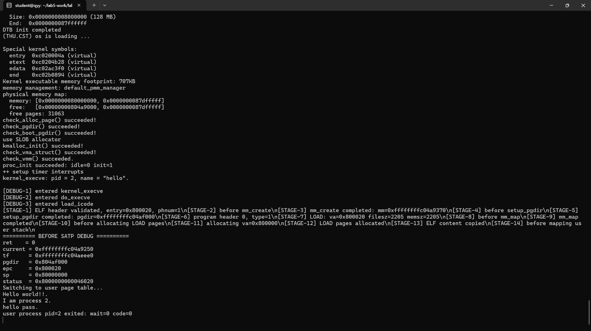
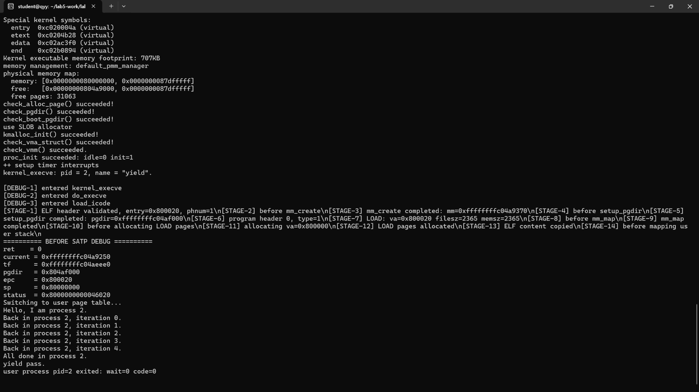
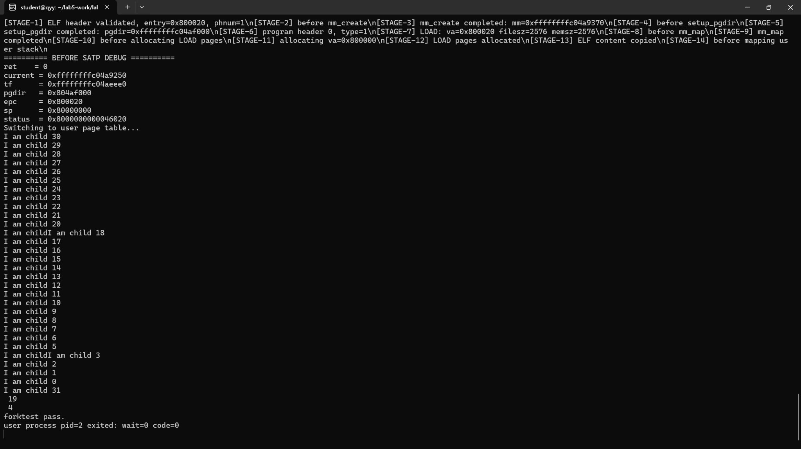

# 操作系统实验报告

## 实验基本信息

  项目         内容
  ------------ ----------------------------------
  实验名称     Lab5：系统调用与用户进程执行
  姓名及学号   【程浩轩】
  实验工程     `~/lab5-work/lab5_new`
  提交分支     lab5

## 小组分工

  -----------------------------------------------------------------------------------------------------------------------------------
  模块                    本报告涉及的任务                                             主要文件
  ----------------------- ------------------------------------------------------------ ----------------------------------------------
  功能模块一              异常处理中的系统调用入口、系统调用分发及各系统调用服务函数   `kern/trap/trap.c`、`kern/syscall/syscall.c`

  功能模块二              进程控制块初始化、内核线程创建、等待子进程、启动用户程序及   `kern/process/proc.c`
                          ELF 装载                                                     
  -----------------------------------------------------------------------------------------------------------------------------------

## 一、实验目的

1.  理解 RISC-V 环境下用户态通过 `ecall`
    进入内核态的基本过程，掌握异常处理程序与系统调用分发程序之间的关系。
2.  理解系统调用号、参数传递、系统调用服务函数和返回值之间的关系，完成实验要求的系统调用接口。
3.  理解进程控制块（PCB）的主要字段及初始化过程，掌握内核线程创建时初始执行现场的构造方法。
4.  理解父进程等待子进程退出的基本过程，掌握进程退出状态和返回码的传递。
5.  理解 ELF
    可执行文件的基本结构，完成用户程序装载、用户地址空间建立、程序段映射和初始用户栈设置。
6.  通过 QEMU
    运行用户程序，检查系统调用、内核线程、用户态切换和进程退出等待等功能。

## 二、实验环境

  ---------------------------------------------------------------------------------------------------------
  项目                                实际使用情况
  ----------------------------------- ---------------------------------------------------------------------
  主机环境                            Windows + WSL Ubuntu

  实验目录                            `~/lab5-work/lab5_new`

  目标架构                            RISC-V 64 位

  内存管理模式                        Sv39

  编译工具链                          `riscv64-unknown-elf-*` 交叉编译工具链

  编译工具                            `make`

  运行环境                            QEMU `virt` 虚拟机、OpenSBI

  主要代码文件                        `kern/trap/trap.c`、`kern/syscall/syscall.c`、`kern/process/proc.c`

  辅助工具                            WSL 终端、Git、QEMU、日志重定向
  ---------------------------------------------------------------------------------------------------------

## 三、实验整体逻辑分析

本次个人负责的两个模块分别处于系统调用处理链路和进程创建、用户程序装载链路中。

模块一负责接收并处理系统调用。当用户程序执行系统调用指令 `ecall`
后，处理器进入异常处理流程。异常处理程序识别异常原因，在系统调用场景下调整返回地址并调用
`syscall()`。系统调用分发程序根据系统调用号找到对应服务函数，将用户传入的参数交给服务函数处理，最后把处理结果写回返回寄存器。

模块二负责准备进程运行所需的数据结构和用户程序执行环境。内核首先初始化进程控制块，再通过内核线程创建流程建立初始线程。初始线程执行用户程序启动函数后，调用
`kernel_execve()`，进一步进入 `do_execve()` 和 `load_icode()`。ELF
装载函数检查可执行文件格式，创建用户地址空间，映射程序段和用户栈，并设置初始寄存器现场。准备完成后，通过
Trap 返回路径进入用户态执行程序。

整体链路可以概括为：

``` text
用户程序执行 ecall
        |
        v
trap / exception_handler
        |
        v
syscall()
        |
        v
根据系统调用号分发
        |
        v
对应的 sys_* 服务函数
        |
        v
返回系统调用结果

proc_init
    |
    v
alloc_proc
    |
    v
kernel_thread
    |
    v
创建并初始化内核线程
    |
    v
init_main / user_main
    |
    v
kernel_execve
    |
    v
do_execve
    |
    v
load_icode
    |
    v
建立用户地址空间并装载 ELF
    |
    v
设置用户态入口和栈
    |
    v
返回用户态执行
```

## 四、实验内容与实现

### 4.1 功能模块一：异常处理与系统调用

**负责人：本人。主要文件：**
`kern/trap/trap.c`、`kern/syscall/syscall.c`。

#### 4.1.1 系统调用的基本过程

系统调用是用户程序请求操作系统内核提供服务的一种接口。用户程序不能直接执行所有特权操作，因此需要通过
`ecall` 指令主动进入内核。

在本实验中，系统调用处理过程主要包括以下步骤：

1.  用户程序按照系统调用约定准备系统调用号和参数。
2.  执行 `ecall`，处理器产生环境调用异常并进入内核异常处理入口。
3.  `exception_handler()` 根据 `cause` 判断异常类型。
4.  对用户态环境调用异常，调整 `epc`，然后调用 `syscall()`。
5.  `syscall()` 根据系统调用号选择相应服务函数。
6.  服务函数完成具体工作，并将返回值交回系统调用框架。
7.  Trap 返回路径恢复用户程序现场，继续执行用户程序。

#### 4.1.2 `exception_handler()`：识别系统调用异常

文件位置：`kern/trap/trap.c`。

该函数根据 TrapFrame 中的 `cause` 判断异常类型。对于 RISC-V
的环境调用异常，用户态 `ecall` 对应异常原因 8，内核态 `ecall`
对应异常原因 9。

处理系统调用时，需要将 `tf->epc` 向后移动 4 字节。原因是 `ecall`
指令长度为 4
字节，如果返回时仍从原地址执行，就会再次执行同一条系统调用指令，形成重复陷入。

完成返回地址调整后，调用 `syscall()`
进入系统调用分发流程。断点异常则根据指令低位判断指令长度，分别跳过 2
字节或 4
字节；其他未处理异常输出异常原因和现场信息，并按当前异常发生位置进行错误处理。

#### 4.1.3 `syscall()`：系统调用分发

文件位置：`kern/syscall/syscall.c`。

系统调用分发的核心是系统调用表。系统调用号作为数组下标，对应位置保存具体服务函数的函数指针。程序取得当前
TrapFrame
中的系统调用号和参数后，检查系统调用号是否在有效范围内，再调用对应的服务函数。

本实验系统调用表涉及以下接口：

  系统调用       服务函数       主要作用
  -------------- -------------- ----------------------------------
  `SYS_exit`     `sys_exit`     结束当前进程并记录退出状态
  `SYS_fork`     `sys_fork`     请求创建子进程
  `SYS_wait`     `sys_wait`     等待指定子进程退出
  `SYS_exec`     `sys_exec`     请求执行新的用户程序
  `SYS_yield`    `sys_yield`    主动请求重新调度
  `SYS_kill`     `sys_kill`     请求结束指定进程
  `SYS_getpid`   `sys_getpid`   获取当前进程 PID
  `SYS_putc`     `sys_putc`     输出一个字符
  `SYS_pgdir`    `sys_pgdir`    获取或输出当前进程页目录相关信息

系统调用表通过指定下标将系统调用号与服务函数关联起来。这样分发程序不需要为每个系统调用编写一套独立的判断流程，新增接口时也可以沿用统一的表结构。

#### 4.1.4 参数传递与返回值

系统调用进入内核后，内核需要从保存的寄存器现场中取得系统调用号和参数。分发程序将参数组织成服务函数所需的参数数组，再调用对应函数。

服务函数返回后，系统调用框架将结果写入约定的返回寄存器，使用户程序能够取得执行结果。对于执行成功的调用，返回值表示对应操作的结果；对于参数错误或操作失败的情况，返回错误码。

#### 4.1.5 模块一涉及的关键文件

  ----------------------------------------------------------------------------------------------------
  文件                                主要职责
  ----------------------------------- ----------------------------------------------------------------
  `kern/trap/trap.c`                  判断异常原因，识别 `ecall`，调整异常返回地址并调用系统调用入口

  `kern/syscall/syscall.c`            维护系统调用表，取得系统调用号和参数，调用服务函数并处理返回值

  `kern/trap/trap.h`                  定义 TrapFrame 等异常处理所需的数据结构

  `kern/trap/trapentry.S`             保存和恢复寄存器现场，提供异常入口及返回路径
  ----------------------------------------------------------------------------------------------------

其中，`trapentry.S`
是系统调用能够正确进入和返回的底层基础；本报告重点说明本人负责的异常分发和系统调用处理逻辑，不将其他模块的汇编实现作为本人独立完成的内容。

### 4.2 功能模块二：进程初始化与用户程序装载

**负责人：本人。主要文件：** `kern/process/proc.c`。

#### 4.2.1 `alloc_proc()`：分配并初始化 PCB

进程控制块 `proc_struct` 用于保存进程运行和管理所需的信息，例如
PID、进程状态、内核栈、父进程、地址空间、TrapFrame 和上下文等。

`alloc_proc()` 首先通过 `kmalloc()` 分配 PCB
空间。分配失败时返回空指针；成功后使用 `memset()`
将结构体清零，再设置初始状态和默认字段。

主要初始化内容包括：

-   `state` 设置为 `PROC_UNINIT`，表示进程尚未进入可运行状态。
-   `pid` 设置为初始无效值，后续再分配正式 PID。
-   `mm`、`context`、`tf` 等字段先清零。
-   初始化进程链表和哈希链表节点。
-   设置默认页目录相关字段，为内核线程使用内核页表做好准备。

通过统一初始化，可以避免 PCB 中保留未确定的旧数据。

#### 4.2.2 `kernel_thread()`：创建内核线程

`kernel_thread()` 的作用是把一个普通 C
函数包装成内核线程，使内核可以按照进程调度和上下文切换的方式运行它。

函数首先构造一个临时
`trapframe`，并将其清零。随后把线程入口函数地址和参数分别保存到约定的寄存器字段中，再设置初始
`epc` 和状态寄存器。

本实验中，初始现场的主要内容为：

  ------------------------------------------------------------------------------
  字段                    设置内容                作用
  ----------------------- ----------------------- ------------------------------
  `tf.gpr.s0`             线程函数地址            在线程入口汇编中作为调用目标

  `tf.gpr.s1`             函数参数                在线程入口汇编中传递给函数

  `tf.epc`                `kernel_thread_entry`   指定线程第一次恢复时的入口

  `tf.status`             设置 S 态返回相关标志   控制 Trap
                                                  返回后的特权级和中断状态
  ------------------------------------------------------------------------------

随后调用 `do_fork(clone_flags | CLONE_VM, 0, &tf)`，由进程创建流程分配
PCB、内核栈并保存初始现场。

这里的 `CLONE_VM` 表示内核线程共享当前内核地址空间。`kernel_thread()`
主要负责准备线程第一次运行时需要的寄存器现场，并不直接完成 CPU
上下文切换。

#### 4.2.3 `do_wait()`：等待子进程退出

`do_wait()` 用于等待指定子进程结束，并取得子进程的退出码。

其主要逻辑包括：

1.  根据 PID 查找目标子进程；如果没有指定
    PID，则按实现要求查找符合条件的子进程。
2.  检查目标进程是否属于当前进程的子进程。
3.  如果子进程已经进入 `PROC_ZOMBIE`
    状态，则读取其退出码，并完成相应的回收处理。
4.  如果子进程仍未退出，则当前进程进入等待状态，等待子进程退出后被唤醒。
5.  如果不存在符合条件的子进程，则返回相应错误。

在本实验的启动流程中，`init_main()` 创建用户程序执行线程后调用
`do_wait()`，等待用户程序结束，并输出等待结果和退出码。

#### 4.2.4 `init_main()` 与 `user_main()`：启动流程

`proc_init()` 完成进程管理结构初始化后，会创建初始内核线程。该线程运行
`init_main()`。

`init_main()` 再创建执行用户程序的内核线程，并通过 `do_wait()`
等待它结束。`user_main()` 负责调用
`KERNEL_EXECVE(hello)`，将内核中链接进来的用户程序映像交给执行装载流程。

因此，这几个函数之间的关系是：

``` text
proc_init()
    |
    v
kernel_thread(init_main, ...)
    |
    v
init_main()
    |
    +---- kernel_thread(user_main, ...)
    |             |
    |             v
    |         user_main()
    |             |
    |             v
    |       KERNEL_EXECVE(hello)
    |             |
    |             v
    |         kernel_execve()
    |
    v
do_wait()
    |
    v
取得用户程序退出状态和退出码
```

#### 4.2.5 `kernel_execve()` 与 `do_execve()`：执行用户程序

`kernel_execve()` 是内核启动用户程序时使用的执行入口。它调用
`do_execve()`，将程序名称、二进制映像地址和映像大小传递给装载流程。

`do_execve()`
首先检查程序名称、长度和二进制映像指针等参数是否合法，然后调用
`load_icode()` 装载 ELF 程序。装载成功后更新当前进程名称。

本次实验的启动场景是由内核启动一个初始用户程序。当前实现范围不等同于完整的用户态
`exec`
替换流程；后续更完整的用户进程执行和地址空间处理由实验其他功能部分继续扩展。

#### 4.2.6 `load_icode()`：装载 ELF 可执行文件

`load_icode()` 是用户程序装载的核心函数，主要完成 ELF
文件检查、地址空间创建、程序段映射、程序内容复制和用户栈初始化。

**（1）检查 ELF 文件格式**

首先检查二进制映像是否为空、文件长度是否足够，并检查 ELF
魔数、程序头表项大小、程序头偏移和程序头数量是否在文件范围内。若格式不正确，返回
ELF 格式错误。

**（2）创建用户地址空间**

通过 `mm_create()` 创建内存管理结构，再通过 `setup_pgdir()`
建立页目录。若分配失败，返回内存不足错误，并释放已经申请的资源。

**（3）遍历 ELF 程序头**

遍历 ELF 程序头表，只处理类型为 `ELF_PT_LOAD`
的可装载段。对每个段检查文件大小和内存大小关系、文件偏移范围、虚拟地址范围等条件，并根据
ELF 段权限设置相应的虚拟内存权限。

**（4）映射并分配程序段页面**

通过 `mm_map()`
建立虚拟内存区域，再按页遍历程序段覆盖的地址范围。对于尚未分配物理页的虚拟地址，调用
`pgdir_alloc_page()` 分配并映射物理页。新页面清零后，再将 ELF
文件中的实际内容复制到对应位置。

**（5）建立用户栈**

通过 `mm_map()`
为用户栈建立虚拟内存区域，并分配初始用户栈所需的物理页。页面清零后，将用户栈指针设置为
`USTACKTOP`。

**（6）设置用户程序初始现场**

装载成功后，将新建的 `mm`
关联到当前进程，更新当前进程的页目录物理地址，并初始化 TrapFrame：

-   `tf->gpr.sp` 设置为 `USTACKTOP`；
-   `tf->epc` 设置为 ELF 文件头中的入口地址 `e_entry`；
-   `tf->status` 设置为从用户态返回所需的状态位。

这样，Trap 返回路径就可以根据初始现场进入用户程序入口执行。

**（7）失败处理**

如果程序段映射、物理页分配或用户栈建立失败，则进入统一错误处理路径，释放已经建立的映射、页目录和内存管理结构，避免资源泄漏。

#### 4.2.7 模块二函数关系

  函数                主要作用
  ------------------- -----------------------------------------------------
  `alloc_proc()`      分配并初始化 PCB
  `kernel_thread()`   构造内核线程初始 TrapFrame
  `do_wait()`         等待子进程结束并取得退出码
  `init_main()`       创建用户程序执行线程并等待其结束
  `user_main()`       启动内核中链接的用户程序
  `kernel_execve()`   调用执行装载流程，成功后进入用户态返回路径
  `do_execve()`       检查执行参数并调用 ELF 装载函数
  `load_icode()`      创建用户地址空间、装载 ELF 程序段并设置用户栈和入口

## 五、测试与验证

### 5.1 编译与启动

实验工程位于
`~/lab5-work/lab5_new`。通过对应的构建目标生成用户程序，再启动 QEMU
观察内核输出。

本次实际使用过的命令包括：

``` bash
cd ~/lab5-work/lab5_new

make build-yield
timeout 20s make qemu 2>&1 | tee ~/lab5_yield_final.log
```

Forktest 集成测试使用过：

``` bash
make build-forktest
timeout 30s make qemu 2>&1 | tee ~/lab5_forktest.log
```

### 5.2 Hello 用户程序测试

在用户程序装载和执行成功后，QEMU 输出包含：

``` text
Switching to user page table...
Hello world!!.
I am process 2.
hello pass.
user process pid=2 exited: wait=0 code=0
```

该结果说明内核完成了用户程序装载和页表切换，用户程序能够正常运行并返回；父进程的等待流程也取得了正常退出结果。

**测试结论：** Hello 测试通过，能够验证模块二中的初始用户程序启动、ELF
装载、用户态执行和退出等待链路。



*图 1：Hello 用户程序运行结果。*

### 5.3 Yield 系统调用测试

执行 `make build-yield` 后运行 QEMU，输出包含：

``` text
Hello, I am process 2.
Back in process 2, iteration 0.
Back in process 2, iteration 1.
Back in process 2, iteration 2.
Back in process 2, iteration 3.
Back in process 2, iteration 4.
All done in process 2.
yield pass.
user process pid=2 exited: wait=0 code=0
```

程序能够多次执行并输出迭代结果，最后出现
`yield pass.`，说明用户程序的主动让出执行请求能够正常返回，相关系统调用链路可以工作。

**测试结论：** Yield 测试通过。



*图 2：Yield 用户程序运行结果。*

### 5.4 Forktest 集成测试

在集成版本中运行 Forktest，终端输出了多个子进程的执行信息，并最终出现：

``` text
forktest pass.
user process pid=2 exited: wait=0 code=0
```

该结果说明当前集成版本能够完成 Forktest
测试，并正常返回用户程序退出状态。

需要说明的是，Forktest
会涉及其他组员负责的进程创建和地址空间复制功能。因此，这项结果作为小组集成版本的验证证据，不作为本人独立完成模块一、模块二的单独评分依据。



*图 3：Forktest 集成测试结果。*

### 5.5 测试结果汇总

  测试项目           观察到的结果                           结论
  ------------------ -------------------------------------- --------------
  Hello              出现 `hello pass.`，退出码为 0         通过
  Yield              出现 0～4 次迭代输出和 `yield pass.`   通过
  Forktest           集成版本出现 `forktest pass.`          集成测试通过
  用户程序退出等待   出现 `wait=0 code=0`                   通过

以上结论依据本次实验实际终端输出整理。Forktest
属于依赖其他模块的集成测试，不将其全部归为个人模块成果。

## 六、实验总结与收获

1.  **系统调用处理：** 通过模块一的实现，理解了用户程序执行 `ecall`
    后进入内核的过程。`exception_handler()`
    负责识别系统调用异常并调整返回地址，`syscall()`
    根据系统调用号分发到相应服务函数，服务函数完成具体操作后再将结果返回用户程序。
2.  **进程控制块初始化：** 通过 `alloc_proc()` 理解了 PCB 的作用，明确了
    PID、进程状态、内核栈、地址空间、TrapFrame
    和上下文等字段在进程管理中的用途。
3.  **内核线程创建：** 通过 `kernel_thread()` 理解了如何把普通 C
    函数转换成内核线程。关键是提前准备函数入口、参数、返回地址和状态寄存器等初始执行现场。
4.  **用户程序装载：** 通过 `load_icode()` 理解了 ELF
    文件头和程序头的作用，掌握了程序段映射、物理页分配、文件内容复制和用户栈初始化的基本流程。
    

