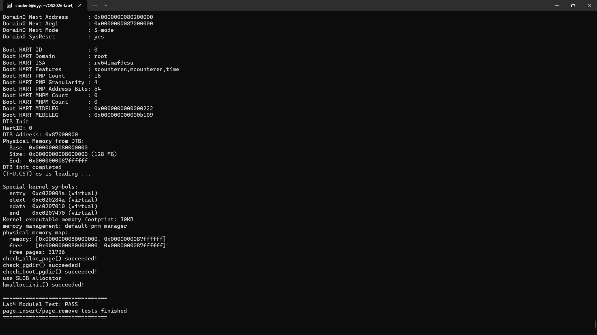
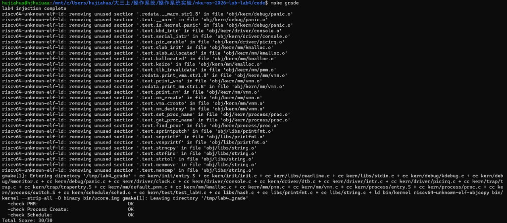

# 操作系统实验报告

## 实验基本信息

| 项目 | 内容 |
|---|---|
| 实验名称 | Lab4：进程与线程管理 |
| 小组成员 | 2411102-程浩轩、2411112-徐子恩、2410935-胡家华 |
| 提交分支 | `lab4` |

## 小组分工

| 学号及姓名 | 负责模块 |
|---|---|
| 2411102-程浩轩 | 功能模块一：虚拟内存页操作 |
| 2411112-徐子恩 | 功能模块二：进程创建与初始化 |
| 2410935-胡家华 | 功能模块三：进程调度与上下文切换 |

## 一、实验目的

1. 理解 Sv39 页表映射、PTE 权限、物理页引用计数与 TLB 同步，完成虚拟页映射的插入和删除。
2. 理解进程控制块的字段与生命周期，完成空闲进程和第一个内核线程的初始化。
3. 掌握内核线程创建时 PCB、内核栈、地址空间、trapframe 与 context 的准备及失败回收流程。
4. 理解进程调度与上下文切换所需的接口及首次运行链路，完成 `schedule()`、`proc_run()`、`cpu_idle()` 和 `switch_to()`。

## 二、实验环境

| 项目 | 实际使用情况 |
|---|---|
| 主机环境 | Windows + WSL Ubuntu-22.04；模块一原独立测试环境的终端用户为 `student` |
| 当前实验工程 | Windows `E:\os实验\lab4`；WSL `/mnt/e/os实验/lab4`；源码及 Makefile 位于 `code/` |
| 模块一原独立测试工程 | `~/OS2026-lab4/lab4_new`（见原测试记录） |
| 目标架构 | RISC-V 64 位，Sv39 三级页表 |
| 编译工具链 | `riscv64-unknown-elf-*` 交叉工具链，`make` |
| 运行环境 | QEMU `virt` 虚拟机，OpenSBI |
| 代码文件 | `code/kern/mm/pmm.c`、`code/kern/mm/default_pmm.c`、`code/kern/mm/memlayout.h`、`code/kern/process/proc.c` |
| 辅助工具 | Python 3（模块一原独立测试中提取与恢复前置实验代码）、终端、AI 编程工具 |

**使用的 AI 工具**

| 成员 | AI 编程工具 | 底层模型 | 备注 |
|---|---|---|---|
| 2411102-程浩轩 | ChatGPT | GPT-6 | 虚拟内存页操作、依赖排查及测试 |
| 2411112-徐子恩 | Codex | GPT-6 | 辅助实现进程创建与初始化、检查源码及编译结果 |
| 2410935-胡家华 | Cursor | Grok 4.7 | 辅助实现进程调度、上下文切换及 Trap 返回 |

## 三、实验整体逻辑分析

Lab4 在已有物理页管理和 Trap 框架上组织进程运行。模块一通过 `page_insert()`、`page_remove()` 维护页表映射；模块二分配 PCB 和内核栈，构造 initproc 的初始寄存器现场并登记为可运行；模块三负责让调度器选中进程并完成上下文切换。模块二设置的初始现场只有在切换和 Trap 返回代码完成后才能真正执行。

| 模块 | 主要任务 | 实现状态 |
|---|---|---|
| 功能模块一：2411102-程浩轩 | `page_insert()`、`page_remove()`；页表映射、引用计数、TLB 一致性 | 已完成，独立测试通过 |
| 功能模块二：2411112-徐子恩 | PCB 初始化、内核线程创建及 `do_fork()` | 代码已实现；整组 `make grade` 为 30/30 |
| 功能模块三：2410935-胡家华 | 空闲进程、进程切换与调度 | 已完成 |

## 四、实验内容与实现

### 4.1 功能模块一：虚拟内存页操作

**负责人：2411102-程浩轩。**

#### 4.1.1 页表映射的含义

用户或内核访问一个虚拟地址时，处理器需要通过页表找到对应物理页。Sv39 采用三级页表，虚拟地址中的索引字段用于逐级定位页表项（PTE）。框架的 `get_pte(pgdir, la, create)` 已经负责找到 `la` 对应的叶子页表项；当 `create` 为真且中间页表不存在时，它会申请物理页存放新页表。本模块实现的两个函数在叶子页表项上操作，而不是重复实现三级页表遍历。

#### 4.1.2 页表项与权限

`pte_create(page2ppn(page), perm)` 使用物理页号和权限构造页表项，并设置有效位 `PTE_V`。本实验的权限标志涉及 `PTE_U`、`PTE_W`、`PTE_R` 等。建立或替换映射后，页表中必须记录新的物理页与相应权限；同一物理页重新插入时，也应允许更新权限。

#### 4.1.3 物理页引用计数

一个物理页可以同时被多个虚拟页引用，因此不能一删除映射就释放物理页。`page_ref_inc(page)` 在增加映射引用时加一；`page_ref_dec(page)` 在撤销映射引用时减一；只有引用计数降到零，才通过 `free_page(page)` 归还物理页。若新的映射目标就是原物理页，则只需要更新 PTE，引用计数保持原值。

#### 4.1.4 TLB 同步

CPU 可能保存旧的虚拟地址转换结果。修改有效 PTE 后需要使对应地址的旧 TLB 项失效。框架提供 `tlb_invalidate(pgdir, la)`，底层使用 `sfence.vma` 完成指定地址的转换缓存同步。

#### 4.1.5 实现位置

实验框架在 `code/kern/mm/pmm.c` 中保留了 `//LAB4 function1 YOUR CODE` 标记。根据任务要求，2411102-程浩轩仅在此标记下新增页映射操作函数，未覆盖 `get_pte()`、`get_page()` 或老师提供的 `check_pgdir()`、`check_boot_pgdir()`。

主要接口：

```c
int page_insert(pde_t *pgdir, struct Page *page,
                uintptr_t la, uint32_t perm);
void page_remove(pde_t *pgdir, uintptr_t la);
```

#### 4.1.6 `page_insert()` 实现思路

1. `get_pte(pgdir, la, 1)` 获取叶子页表项；若申请中间页表失败，返回 `-E_NO_MEM`。
2. 为新物理页增加引用计数。
3. 如果原 PTE 已有效，使用 `pte2page(*ptep)` 找到旧物理页：
   - 原物理页与目标物理页相同，抵消刚增加的引用计数，避免重复计数；
   - 如果是不同物理页，先撤销旧映射并减少旧页引用计数，归零时释放旧页。
4. 使用 `pte_create(page2ppn(page), perm)` 写入新的有效叶子 PTE。
5. 执行 `tlb_invalidate(pgdir, la)`，返回零。

```c
pte_t *ptep = get_pte(pgdir, la, 1);
if (ptep == NULL) {
    return -E_NO_MEM;
}
page_ref_inc(page);
if (*ptep & PTE_V) {
    struct Page *old_page = pte2page(*ptep);
    if (old_page == page) {
        page_ref_dec(page);
    } else {
        *ptep = 0;
        if (page_ref_dec(old_page) == 0) {
            free_page(old_page);
        }
    }
}
*ptep = pte_create(page2ppn(page), perm);
tlb_invalidate(pgdir, la);
return 0;
```

#### 4.1.7 `page_remove()` 实现思路

1. 以 `create=0` 调用 `get_pte()`，不为删除操作分配新页表。
2. 若页表项不存在或没有 `PTE_V`，直接返回。
3. 找到原物理页，清除 PTE；引用计数减一，降至零时释放物理页。
4. 调用 `tlb_invalidate()`，让后续访问不能继续使用旧映射。

```c
pte_t *ptep = get_pte(pgdir, la, 0);
if (ptep == NULL || !(*ptep & PTE_V)) {
    return;
}
struct Page *page = pte2page(*ptep);
*ptep = 0;
if (page_ref_dec(page) == 0) {
    free_page(page);
}
tlb_invalidate(pgdir, la);
```

#### 4.1.8 关键接口之间的关系

| 接口 | 在模块一中的作用 |
|---|---|
| `get_pte()` | 查找叶子 PTE，必要时创建中间页表 |
| `pte2page()` | 由有效 PTE 找到对应的 `Page` 描述符 |
| `page2ppn()` / `pte_create()` | 将目标物理页写为有效 PTE |
| `page_ref_inc()` / `page_ref_dec()` | 跟踪物理页映射引用 |
| `free_page()` | 归还已无映射引用的物理页 |
| `tlb_invalidate()` | 同步页表变更与处理器地址转换缓存 |

#### 4.1.9 独立编译与 QEMU 测试

以下记录来自 2411102-程浩轩在原独立测试工程中的验证；截图保留原样，不能视为当前三模块联合运行结果。

**编译验证**

在项目根目录执行：

```bash
cd ~/OS2026-lab4/lab4_new
make clean
make -k
```

恢复 Lab2 基础功能后，日志出现 `+ cc kern/mm/default_pmm.c`、`+ cc kern/mm/pmm.c`、`+ cc kern/mm/vmm.c`，证明相关 C 文件编译完成。首次完整链接因当时 `proc_init`、`cpu_idle` 缺失而失败；之后使用临时模块一独立测试启动入口，重新编译并启动 QEMU。当前仓库中这些源码路径分别位于 `code/kern/mm/` 下。

**QEMU 独立运行**

临时测试版本使用：

```bash
make clean
make
make qemu
```

QEMU 输出显示设备树解析了 128 MB 物理内存，初始化后空闲页数为 **31,736**，关键输出如下：

```text
Physical Memory from DTB:
    Base: 0x0000000080000000
    Size: 0x0000000008000000 (128 MB)
...
free pages: 31736
check_alloc_page() succeeded!
check_pgdir() succeeded!
check_boot_pgdir() succeeded!
use SLOB allocator
kmalloc_init() succeeded!

==============================
Lab4 Module1 Test: PASS
page_insert/page_remove tests finished
==============================
```

> 此处 `Lab4 Module1 Test: PASS` 为**临时测试入口在** `pmm_init()` **正常返回后打印的标识**，并不是额外一套自动评分程序；主要功能证据是框架自带的 `check_pgdir()` 与 `check_boot_pgdir()` 通过。



*图 1：2026-11-10 的 QEMU 运行截图。截图显示* `check_alloc_page()`*、*`check_pgdir()`*、*`check_boot_pgdir()` *和模块一测试结束标识。*

**测试覆盖情况**

| 测试点 | 实际依据 | 结果 |
|---|---|---|
| 基础物理页分配器 | `check_alloc_page()` | 通过 |
| 插入虚拟页映射及引用计数 | `check_pgdir()` 的断言 | 通过 |
| 替换映射、访问权限与删除操作 | `check_pgdir()` 的断言 | 通过 |
| 同一物理页映射到两个虚拟地址、地址访问一致性 | `check_boot_pgdir()` | 通过 |
| 内核小对象分配器初始化 | `kmalloc_init()` | 通过 |

### 4.2 功能模块二：进程创建与初始化

**负责人：2411112-徐子恩。实现文件：**`code/kern/process/proc.c`**。** 本模块只准备和登记内核线程；进程被调度后的实际执行依赖模块三和 Trap 返回代码。`proc.h` 中的 `proc_struct` 包含状态、PID、内核栈、父进程、`mm`、`context`、`tf`、页表地址，以及全局链表和哈希链表节点。

#### 4.2.1 `alloc_proc()`：分配与初始化进程控制块

```c
struct proc_struct *proc = kmalloc(sizeof(struct proc_struct));
if (proc == NULL) {
    return NULL;
}
memset(proc, 0, sizeof(struct proc_struct));
proc->state = PROC_UNINIT;
proc->pid = -1;
proc->pgdir = boot_pgdir_pa;
list_init(&proc->list_link);
list_init(&proc->hash_link);
return proc;
```

`kmalloc()` 为 PCB 分配空间，失败直接返回 `NULL`。整块清零使 `runs`、`kstack`、`need_resched`、`parent`、`mm`、`context`、`tf`、`flags` 和名称均有确定初值。随后用 `PROC_UNINIT` 标记尚未可运行，用 `-1` 表示 PID 尚未分配；内核线程先使用物理地址为 `boot_pgdir_pa` 的启动页表。两个链表节点各自初始化，供后续插入进程链表与 PID 哈希表。

#### 4.2.2 `proc_init()`：进程管理系统初始化

**管理结构初始化：**

```c
int i;
list_init(&proc_list);
for (i = 0; i < HASH_LIST_SIZE; i++) {
    list_init(&hash_list[i]);
}
```

全局进程链表和每个哈希桶都先成为空的双向链表，之后 `hash_proc()`、`find_proc()` 才能安全使用。

**idleproc 创建：**

```c
idleproc = alloc_proc();
assert(idleproc != NULL);
idleproc->pid = 0;
idleproc->state = PROC_RUNNABLE;
idleproc->kstack = (uintptr_t)bootstack;
idleproc->need_resched = 1;
set_proc_name(idleproc, "idle");
nr_process = 1;
current = idleproc;
```

idleproc 是启动后当前运行的进程，PID 固定为 0。它复用启动汇编在 `entry.S` 中预留的 `bootstack`，因此无须调用 `setup_kstack()` 重复分配。`need_resched = 1` 为之后的调度留出切换需求，`nr_process = 1` 和 `current = idleproc` 建立初始进程管理状态。断言在 PCB 分配失败时立即暴露初始化问题。

**initproc 创建：**

```c
int pid = kernel_thread(init_main, "Hello world!!", 0);
assert(pid > 0);
initproc = find_proc(pid);
assert(initproc != NULL && initproc->pid == pid);
set_proc_name(initproc, "init");
assert(nr_process == 2);
```

`kernel_thread()` 返回新线程 PID；`find_proc()` 通过 PID 哈希表定位 PCB，再命名为 `init`。三个断言分别核对创建成功、哈希登记正确和进程数量正确；它们只检查创建后的内核数据结构，并不证明 initproc 已经获得 CPU 执行。

#### 4.2.3 `kernel_thread()`：创建内核线程的入口

```c
struct trapframe tf;
memset(&tf, 0, sizeof(tf));
tf.gpr.s0 = (uintptr_t)fn;
tf.gpr.s1 = (uintptr_t)arg;
tf.epc = (uintptr_t)kernel_thread_entry;
tf.status = (read_csr(sstatus) | SSTATUS_SPP | SSTATUS_SPIE) & ~SSTATUS_SIE;
return do_fork(clone_flags | CLONE_VM, 0, &tf);
```

局部 `trapframe` 清零后承载新线程第一次从 Trap 返回时的寄存器现场。`s0`、`s1` 分别保存函数地址和参数，依据是 `code/kern/process/entry.S` 的实际入口：

```asm
kernel_thread_entry:
    move a0, s1
    jalr s0
    jal do_exit
```

入口把 `s1` 移入按 RISC-V 调用约定传参的 `a0`，再通过 `s0` 调用 `fn(arg)`；函数返回值留在 `a0`，随后传给 `do_exit()`。`epc` 指向该入口，供未来 `sret` 作为起始执行地址。`SSTATUS_SPP` 选择返回后的 S 特权级，`SSTATUS_SPIE` 使 `sret` 后中断可用，清除 `SSTATUS_SIE` 使准备中的现场保持中断关闭状态。调用 `do_fork(clone_flags | CLONE_VM, 0, &tf)` 标明内核线程共享地址空间，栈参数 0 由 `copy_thread()` 解释为使用新内核栈顶部。本函数只构造初始现场，不负责模块三的 `switch_to()`。

#### 4.2.4 `copy_mm()`：地址空间处理

```c
static int
copy_mm(uint32_t clone_flags, struct proc_struct *proc)
{
    // Lab4 仅创建内核线程，所有线程共用启动页表。
    (void)clone_flags;
    if (current->mm != NULL) {
        return -E_INVAL;
    }
    proc->mm = NULL;
    proc->pgdir = boot_pgdir_pa;
    return 0;
}
```

当前实现要求父进程没有用户地址空间；若 `current->mm` 非空便返回 `-E_INVAL`，避免把用户进程误当作内核线程复制。新线程的 `mm = NULL`，`pgdir = boot_pgdir_pa`，表示使用内核启动页表。`clone_flags` 在本阶段只由调用方传入并显式标记未使用；代码没有实现用户 VMA、页表或物理页的复制，不能等同于后续完整的用户进程 `fork`。

#### 4.2.5 `copy_thread()`：初始化执行上下文

```c
proc->tf = (struct trapframe *)(proc->kstack + KSTACKSIZE - sizeof(struct trapframe));
*proc->tf = *tf;
proc->tf->gpr.a0 = 0;
proc->tf->gpr.sp = (esp != 0) ? esp : proc->kstack + KSTACKSIZE;
proc->context.ra = (uintptr_t)forkret;
proc->context.sp = (uintptr_t)proc->tf;
```

内核栈从 `kstack` 向高地址延伸至 `kstack + KSTACKSIZE`，栈顶下方保留一个 `trapframe`，并复制 `kernel_thread()` 准备的初始现场。将新进程的 `a0` 设为 0，符合子进程从 fork 路径返回零的约定；对本实验线程，入口汇编随后会用 `s1` 覆盖 `a0`，传入 `fn(arg)`。`esp` 非零时采用调用方给定栈指针；为零时使用新内核栈顶部。`context.ra = forkret` 使第一次上下文切换返回到 `forkret()`，`context.sp` 指向刚放入栈中的 trapframe，以便 `forkret → forkrets` 交给 Trap 返回路径。`context` 保存内核切换所需的寄存器，`trapframe` 保存线程首次恢复的完整寄存器现场，两者用途不同。

#### 4.2.6 `do_fork()`：完整的进程创建流程

**（1）创建条件检查。**

```c
if (nr_process >= MAX_PROCESS) {
    return -E_NO_FREE_PROC;
}
if (tf == NULL) {
    return -E_INVAL;
}
```

进程数达到上限时直接返回资源错误；没有初始 trapframe 时返回参数错误。两项检查都发生在分配资源之前。

**（2）分配资源并建立父进程关系。**

```c
struct proc_struct *proc = alloc_proc();
if (proc == NULL) {
    return -E_NO_MEM;
}
proc->parent = current;
int ret = setup_kstack(proc);
if (ret != 0) {
    goto bad_proc;
}
```

先申请 PCB，并让新进程指向当前进程作为父进程；随后 `setup_kstack()` 分配 `KSTACKPAGE` 个连续物理页作为内核栈。若栈分配失败，仅需回收已申请的 PCB。

**（3）初始化地址空间与线程现场。**

```c
if ((ret = copy_mm(clone_flags, proc)) != 0) {
    goto bad_kstack;
}
copy_thread(proc, stack, tf);
```

`copy_mm()` 验证并设置内核地址空间；成功后 `copy_thread()` 才在已分配的内核栈中写入 trapframe 和 context。地址空间检查失败时，内核栈和 PCB 都要回收。

**（4）登记新进程。**

```c
bool intr_flag;
local_intr_save(intr_flag);
proc->pid = get_pid();
hash_proc(proc);
list_add(&proc_list, &proc->list_link);
nr_process++;
```

保存并关闭本地中断，避免 PID 分配、哈希登记、全局链表插入和数量更新的临界区被中断处理打断。此时 PCB、内核栈和初始现场均已准备好。

**（5）唤醒并返回。**

```c
wakeup_proc(proc);
local_intr_restore(intr_flag);
return proc->pid;
```

`wakeup_proc()` 将已登记的新进程从 `PROC_UNINIT` 改为 `PROC_RUNNABLE`；恢复原中断状态后向父进程返回 PID。可运行状态只表示具备调度资格，不代表已经执行。

**（6）失败回收。**

```c
bad_kstack:
    put_kstack(proc);
bad_proc:
    kfree(proc);
    return ret;
```

两个标签按资源申请的逆序工作：`bad_kstack` 先释放内核栈，再落入 `bad_proc` 释放 PCB；栈申请失败则直接从 `bad_proc` 回收 PCB。失败进程没有进入链表、哈希表或可运行状态。

#### 4.2.7 模块二整体流程

`proc_init → kernel_thread → do_fork → alloc_proc → setup_kstack → copy_mm → copy_thread → get_pid/hash_proc/加入进程链表 → wakeup_proc`。初始化先建立进程管理结构，`kernel_thread()` 准备 `init_main` 的初始现场，`do_fork()` 顺序分配资源、登记 PID 并使 initproc 可运行。

预期首次执行链路为 `switch_to → forkret → forkrets → __trapret → kernel_thread_entry → fn(arg)`。`forkret()` 调用 `forkrets(current->tf)`；`forkrets` 把栈指针设为 trapframe 地址，再转入 `__trapret`。后续真正运行依赖模块三的切换实现和 Trap 返回汇编。

### 4.3 功能模块三：进程调度与上下文切换

**负责人：2410935-胡家华**

本模块把已经创建好的 `PROC_RUNNABLE` 进程真正跑起来。`cpu_idle()` 在空闲进程里循环，发现 `need_resched` 就调用 `schedule()`。`schedule()` 从当前进程在 `proc_list` 中的下一个位置开始，跳过睡眠、未初始化和僵尸进程，选出下一个可运行进程；找不到别人时，若当前进程仍可运行就继续跑自己，否则回到 `idleproc`。真正换 CPU 由 `proc_run()` 完成：更新 `current`，页表不同时重写 `satp` 并 `sfence.vma`，再调用 `switch_to()`。`switch_to()` 按 `struct context` 的顺序保存、恢复 `ra`、`sp` 和 `s0`–`s11`。新线程的 `ra` 是 `forkret`，因此第一次被调度时进入 `forkret → forkrets → __trapret → kernel_thread_entry`。

`schedule()` 的选择逻辑：

```c
last = (current == idleproc) ? &proc_list : &(current->list_link);
do {
    if ((le = list_next(le)) != &proc_list) {
        next = le2proc(le, list_link);
        if (next->state == PROC_RUNNABLE) {
            break;
        }
    }
} while (le != last);
if (next == NULL || next->state != PROC_RUNNABLE) {
    next = (current->state == PROC_RUNNABLE) ? current : idleproc;
}
if (next != current) {
    proc_run(next);
}
```

首次运行还依赖 Lab3 留下的 Trap 返回。`trapentry.S` 中补上了 `RESTORE_ALL` 和 `__alltraps` 到 `trap()` 的调用；`trap.c` 中补上时钟中断处理，并在时钟中断里置 `need_resched`。

## 五、测试与验证

在 WSL 的 `code/` 目录执行 `make grade`，三项检查均通过：

```text
  -check PMM:                                OK
  -check Process Create:                     OK
  -check Schedule:                           OK
Total Score: 30/30
```

调度检查同时要求出现 `this initproc, pid = 1, name = "init"`、`To U: "Hello world!!".` 和 `To U: "en.., Bye, Bye. :)"`。本机 OpenSBI 不能用 `-device loader` 进入内核，因此 `Makefile` 和 `tools/grade.sh` 改为 `-kernel bin/ucore.img`。`kmalloc.c` 把整数地址传给 `kva2page(void *)` 会触发 `-Werror`，已改为 `(void *)kva`。评分线程原来返回 `void`，与 `kernel_thread(int (*)(void *))` 不一致，只把 `tools/test_lab4.c` 中该函数改成 `int` 并补上 `return 0`，断言没有改。



*图 2：在 WSL 的 `code/` 目录执行 `make grade` 的结果。物理内存、进程创建和调度三项均为 OK，总分为 30/30。*

## 六、扩展练习

### 6.1 `local_intr_save` / `local_intr_restore` 如何开关中断

`schedule()`、`proc_run()` 和 `do_fork()` 修改进程链表、`current` 或页表时，都包在下面这对语句里：

```c
local_intr_save(intr_flag);
/* 临界区 */
local_intr_restore(intr_flag);
```

实现在 `code/kern/sync/sync.h`。`local_intr_save(intr_flag)` 把 `__intr_save()` 的返回值存进 `intr_flag`。`__intr_save()` 读取 `sstatus`，检查 `SSTATUS_SIE`（第 1 位）。该位为 1 表示当前 S 态允许响应中断，函数调用 `intr_disable()`，也就是 `clear_csr(sstatus, SSTATUS_SIE)`，把这一位清 0，并返回 1。该位已经是 0 时，函数不改寄存器，返回 0。

`local_intr_restore(intr_flag)` 只有在 `intr_flag` 为 1 时才调用 `intr_enable()`，即 `set_csr(sstatus, SSTATUS_SIE)`。进入临界区前中断本来就是关闭的，退出后仍然关闭。

因此它可以嵌套。内层看到 SIE 已经是 0，保存的标志是 0，内层恢复不会打开中断；只有最外层保存到的 1 才会重新置位。陷入内核时，硬件已经把 SIE 清 0，并把原来的值留在 SPIE。这时 `local_intr_save` 得到 0，临界区结束不会提前开中断，真正恢复发生在 `sret` 把 SPIE 写回 SIE 的时候。

调度需要这个临界区。`schedule()` 正在改 `need_resched`、选择下一个进程并切换 `current` 时，如果时钟中断进来再次调用 `schedule()`，进程指针和 `switch_to()` 保存的寄存器现场会对不上。

### 6.2 分页模式与 `get_pte()`

`get_pte()` 在 `code/kern/mm/pmm.c`。它从根页表 `pgdir` 出发，先用 `PDX1(la)` 走一级，再用 `PDX0(la)` 走一级，最后返回 `PTX(la)` 对应的叶子页表项地址。前两级的代码几乎一样：页表项没有 `PTE_V` 时，若 `create` 为真就分配一页、引用计数设为 1、整页清零，并写成指向下一级的页表项；然后用 `PDE_ADDR` 取出下一级页表的物理地址，经 `KADDR` 转成内核虚拟地址再继续索引。

Sv32、Sv39、Sv48 都是基数页表，页大小都是 4KiB，页内偏移都是虚拟地址的低 12 位。非叶子页表项都不带 R/W/X，里面的物理页号指向下一级页表。差别是地址宽度、级数和每一级索引占多少位：

| 模式 | 虚拟地址 | `satp.MODE` | 级数 | 每一级索引 |
|---|---|---|---|---|
| Sv32 | 32 位，只用于 RV32 | 1 | 2 | 10 位，每页 1024 个 4 字节页表项 |
| Sv39 | 39 位，高位按符号扩展 | 8 | 3 | 9 位，每页 512 个 8 字节页表项 |
| Sv48 | 48 位，高位按符号扩展 | 9 | 4 | 9 位，每页 512 个 8 字节页表项 |

本实验 `mmu.h` 中 `PDX1SHIFT` 是 30，`PDX0SHIFT` 是 21，`PTXSHIFT` 是 12，掩码都是 `0x1FF`。这三项就是 Sv39 的 VPN[2]、VPN[1]、VPN[0]。Sv39 和 Sv48 的每一级都占满一页，索引都是 9 位，页表项格式也相同，所以“检查有效位、按需分配并清零、装上下一级指针”在每一级都成立。`get_pte()` 里那两段代码只是把 VPN[2] 和 VPN[1] 各写了一遍。Sv48 还要再写一段处理 VPN[3]。Sv32 只有一级非叶子页表，索引是 10 位，页表项是 4 字节，不会是现在这种两段 9 位拷贝。叶子一级不再分配页表，只按 `PTX(la)` 算出位置并返回，所以没有第三段同样的代码。

把查找和分配放在同一个 `get_pte()` 里，对现在的调用者是合适的。`page_insert()` 传入 `create=1`，缺中间页表时直接得到叶子项；`page_remove()` 传入 `create=0`，缺页表就返回空，不会为了删除去新建页表。调用者不用自己再走一遍多级页表。

两段几乎相同的语句会随着页表级数继续复制。更合适的做法是仍然只对外提供 `get_pte()`，在函数内部按移位循环处理每一级，而不是拆成“查找函数”和“分配函数”两个公开接口。拆开之后，`page_insert()` 还是要把两次操作串起来，接口变多，页表行走的规则并没有少。

当前写法还有一个失败路径：VPN[2] 那一页已经分配并挂上，VPN[1] 再分配失败时，函数直接返回 `NULL`，刚分配的页表页不会释放。把函数拆成两个公开接口也不能自动补上这次回收。若要修改，应仍在这一次 `get_pte()` 调用中记下新分配的页，失败时释放它们。

## 七、实验总结与收获

1. **虚拟内存页操作：** 模块一通过 `get_pte()` 定位叶子 PTE，在插入、替换和删除映射时同时维护权限、物理页引用计数及 TLB 一致性。独立测试中，`check_pgdir()` 与 `check_boot_pgdir()` 通过，帮助小组将页表操作与后续进程地址空间管理联系起来。
2. **进程创建与初始化：** 模块二梳理了 PCB、内核栈和地址空间的分工：PCB 记录 PID、状态及进程关系；每个新内核线程拥有自己的内核栈，但当前阶段共用启动页表。`PROC_UNINIT` 只有在资源、trapframe 和 context 均准备完毕、PID 已登记后才转为 `PROC_RUNNABLE`。`context` 服务于内核上下文切换，`trapframe` 服务于首次寄存器恢复；两者通过 `forkret` 和 `forkrets` 衔接。
3. **调度与切换：** 模块三用链表轮转选择下一个 `PROC_RUNNABLE` 进程，`switch_to()` 只保存被调用者寄存器。新内核线程第一次运行不回到旧的 C 调用点，而是从 `forkret` 进入 Trap 返回，再跳到 `kernel_thread_entry`。
4. **扩展练习：** `local_intr_save/restore` 按进入临界区前的 `sstatus.SIE` 关闭并恢复 S 态中断，可以嵌套。`get_pte()` 中两段相似代码对应 Sv39 的两级非叶子页表；查找和分配保持在同一个函数里，适合现在的调用方式。

