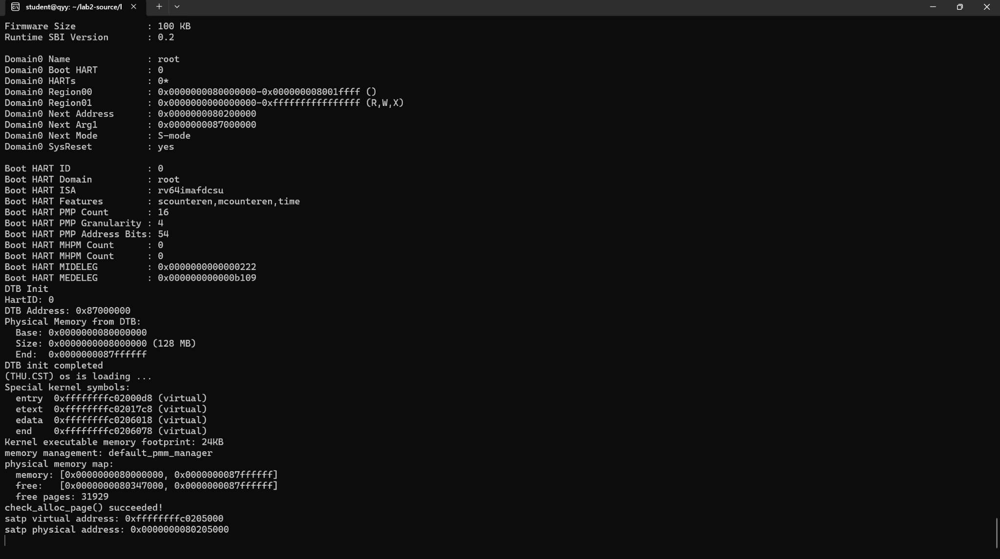

# 操作系统实验二：物理内存与页表——实验报告

 
> 小组成员：程浩轩，徐子恩，胡家华  
> 实验环境：Windows + WSL Ubuntu、RISC-V GCC、QEMU、Git/GitHub  
> 提交分支：`lab2`  

## 一、实验目标与总体思路
整体流程为：

```text
QEMU/OpenSBI 启动 → kern_entry → kern_init()
                                  ↓
                            pmm_init()
                                  ↓
                        init_pmm_manager()
                                  ↓
       page_init()：获取内存信息、建立 Page 数组、注册空闲页
                                  ↓
          check_alloc_page()：调用分配器自己的 check()
                                  ↓
          后续分配器实验：First-Fit → Best-Fit → Buddy System
```


### 1.1 小组分工与完成情况

| 成员 | 负责内容 | 当前状态 |
|---|---|---|
| 程浩轩| `page_init()` 物理内存探测和页描述符初始化；First-Fit 原理分析
## 二、实验环境和代码结构

实验继续使用 Lab1 已配置的 WSL Ubuntu 环境，工具包括 `riscv64-unknown-elf-gcc`、`qemu-system-riscv64` 和 Git。Lab2 代码来自课程提供的压缩包，实际工程目录为 `~/lab2-source/lab2_new`；协作版本上传到 GitHub 仓库的 `lab2` 分支。

重要文件如下：

| 文件 | 作用 |
|---|---|
| `kern/driver/dtb.c`、`dtb.h` | 获取设备树提供的物理内存起点和大小 |
| `kern/mm/pmm.c` | 组织内存管理器初始化、`page_init()`、分配测试 |
| `kern/mm/pmm.h`、`memlayout.h` | 定义 `Page`、`pmm_manager`、地址转换函数和内存范围常量 |
| `kern/mm/default_pmm.c` | 原有 First-Fit 分配器及测试 |
| `kern/mm/best_fit_pmm.c` | B 负责的 Best-Fit 实现文件 |
| `kern/init/entry.S` | 启动入口及早期页表相关代码 |
| `Makefile` | 编译和 QEMU 启动规则 |

## 三、程浩轩：物理内存初始化功能

### 3.1 任务要求与设计思路

实现 `kern/mm/pmm.c` 中的 `static void page_init(void)`，依据设备树信息建立物理页面描述符布局，并将排除了 OpenSBI、内核和描述符数组占用区域之后的完整空闲页交给当前 `pmm_manager`。函数不需要传参或返回值；正常完成后应正确设置 `va_pa_offset`、`npage`、`pages` 等全局量。

思路是：先取物理内存范围并验证合法性，再确定允许管理的内存上界，设置内核虚拟地址到物理地址的偏移；随后在内核末尾之后按页对齐放置 `Page` 数组，用它记录物理页状态。描述符占用的空间也不能再分配，所以将其末尾向上对齐，作为真正空闲空间的起点。最后把这些空闲页交给 `init_memmap()`。

### 3.2 关键代码及理解

实现位置是 `pmm.c` 中原有的 `//lab2 function1 YOUR CODE` 标记处。实际使用的主要接口有 `get_memory_base()`、`get_memory_size()`、`panic()`、`PADDR()`、`pa2page()` 和 `init_memmap()`。

**（1）探测和限制物理内存范围**

```c
uint64_t mem_base = get_memory_base();
uint64_t mem_size = get_memory_size();

if (mem_size == 0 || mem_base != DRAM_BASE ||
    mem_size > ((uint64_t)-1) - mem_base) {
    panic("invalid physical memory information");
}

uint64_t mem_end = mem_base + mem_size;
if (mem_end > PHYSICAL_MEMORY_END) {
    mem_end = PHYSICAL_MEMORY_END;
}
```

这里不能直接把设备树读到的大小当成全部可用内存。程序先排除零大小、当前内核布局不支持的内存起点和加法溢出，再根据本实验的可管理上界限制 `mem_end`。`mem_base == DRAM_BASE` 是这一版代码针对当前 QEMU 内存布局采用的限制，并不是所有硬件设备都必须满足的通用条件。

**（2）设置页面范围与描述符数组**

```c
va_pa_offset = PHYSICAL_MEMORY_OFFSET;
npage = PPN(mem_end);
pages = (struct Page *)ROUNDUP((uintptr_t)end, PGSIZE);
size_t page_count = npage - nbase;
```

`va_pa_offset` 用于完成内核虚拟地址和物理地址的转换；`npage` 在这个框架中是物理页号上界，`pages` 是描述符数组的虚拟地址。需要特别注意：`Page` 并不是一页实际数据，它保存的是该物理页的引用计数、状态标志和空闲块信息。`page_count` 才是这份描述符数组要覆盖的页数。

**（3）计算空闲页范围**

```c
uintptr_t metadata_start = PADDR(pages);
uintptr_t metadata_size = page_count * sizeof(struct Page);
uintptr_t free_start = ROUNDUP(metadata_start + metadata_size, PGSIZE);
uintptr_t free_end = ROUNDDOWN(mem_end, PGSIZE);
```

描述符数组也需要占内存，因此不能把 `end` 后面的空间直接视为全部空闲页。必须先跳过 `Page` 数组，再做页对齐。实际代码还检查了描述符空间不足和没有完整空闲页的情况，对不符合要求的情形执行 `panic()`。

**（4）初始化保留页并注册空闲页**

```c
for (size_t i = 0; i < page_count; i++) {
    pages[i].flags = 0;
    pages[i].property = 0;
    set_page_ref(&pages[i], 0);
    SetPageReserved(&pages[i]);
}

size_t free_count = (free_end - free_start) / PGSIZE;
init_memmap(pa2page(free_start), free_count);
```

先把所有描述符标记为保留，确保不能误分配给其他代码；然后由当前管理器的 `init_memmap()` 将真正可用的区域改成空闲状态，并放入其管理结构。当前采用的是 `default_pmm_manager`，也就是 First-Fit 实现。

> 说明：以上摘录的是本次实际编写逻辑中的关键语句，不是全部函数。完整实现以 GitHub `lab2` 分支中的 `kern/mm/pmm.c` 为准；正式提交前应将标记中的 `YOUR CODE` 按指导书要求替换为组员 A 的学号，并保留 `lab2` 注释。

### 3.3 `spec` 与 AI 提示词记录

本题在指导书中给出了详细的函数接口及约束，可将其整理为以下 `spec`：

- 输入：无参数；内存范围来自设备树接口。
- 输出：无返回值；设置 `va_pa_offset`、`npage`、`pages`，打印物理内存信息，注册空闲物理页。
- 约束：正确区分虚拟地址与物理地址；保证内核和描述符数组不进入空闲区；正确按页对齐；无效设备树信息、无可用完整页应报错；不修改其他分配器的测试函数。
- 验证：至少通过编译、QEMU 启动和当前 First-Fit 的 `check_alloc_page()`。

**AI 交流记录说明：** 下列文字是根据实际开发问题整理的 *提示词摘要／可复用表达*，不冒充逐字聊天记录。需要老师要求的原始 prompt 时，应把实际聊天中使用过的请求原文另附到 `prompt.md`。

| 阶段 | 提示词摘要 | 处理结果 |
|---|---|---|
| 阅读工程 | “我已经找到 `pmm.c` 里的 `lab2 function1 YOUR CODE`，帮我分析实现 `page_init()` 需要哪些变量和函数，最好按实验源码来说明。” | 确认设备树接口、地址偏移、`Page` 数组及空闲页注册流程 |
| 生成初稿 | “根据这份 Lab2 的 `pmm.c` 和相关头文件，实现物理内存探测及页描述符初始化，不要动 Best-Fit 部分。” | 完成 `page_init()` 初稿 |
| 排查编译 | “编译报错 `free_list`、`nr_free` 未定义，但错误来自 `best_fit_pmm.c`，A 只做初始化，怎样暂时避开 B 未完成的代码？” | 临时修改 Makefile，排除 Best-Fit 源文件 |
| 修复代码 | “`UINT64_MAX` 未定义，怎样在内核编译环境里处理内存大小溢出检查？” | 改为 `((uint64_t)-1)` 表达式 |
| 运行验证 | “QEMU 只显示 OpenSBI，没有内核信息，怎么判断是加载参数还是 `page_init()` 问题？” | 改用 `-kernel` 参数成功启动内核 |
| 输出整理 | “内存信息把 `\\n` 打成了普通字符，怎么修复？” | 修正 C 字符串转义后输出正常 |

### 3.4 开发中遇到的问题及解决方法

**问题一：实验初始代码无法完整编译。** 编译到 `best_fit_pmm.c` 时出现 `free_list`、`nr_free` 未声明。这部分属于 B 尚未实现的模块，不是 `page_init()` 的错误。为单独测试功能，临时在 Makefile 源文件列表中过滤 `kern/mm/best_fit_pmm.c`。

**问题二：`UINT64_MAX` 未定义。** 由于当前内核编译环境中没有可用的宏定义，改用 `((uint64_t)-1)` 表示无符号 64 位最大值，重新编译成功。

**问题三：QEMU 只显示 OpenSBI。** 起初 Makefile 用 `-device loader,file=...,addr=0x80200000` 加载镜像，没观察到内核输出。改为 `-kernel bin/ucore.img` 后，设备树初始化、内核加载和 `pmm_init()` 都正常运行。随后把成功的加载方式用于 Makefile。

**问题四：打印格式不整齐。** 起初打印字符串的换行符多了一层转义，屏幕出现字面的 `\n`。改正后，内存范围和空闲页数量能够逐行输出。

### 3.5 实验结果和分析

本次使用当前 QEMU 配置启动，设备树输出的物理内存为 128 MB，起始物理地址 `0x80000000`，终止地址 `0x87ffffff`。`page_init()` 执行后输出如下：

```text
memory management: default_pmm_manager
physical memory map:
  memory: [0x0000000080000000, 0x0000000087ffffff]
  free:   [0x0000000080347000, 0x0000000087ffffff]
  free pages: 31929
check_alloc_page() succeeded!
```

截图：



从结果看，程序没有把内核和 `Page` 描述符占用的区域加入空闲链表；空闲区域从 `0x80347000` 开始，共有 31929 页。`check_alloc_page() succeeded!` 表明当前默认分配器的内置检查通过。该结果支持“当前配置下初始化和已有分配测试正常”，但尚不能证明设备树异常、不同内存布局等边界情况全部通过。

## 四、组员 A：First-Fit 分配算法分析

### 4.1 整体数据结构

`default_pmm.c` 使用 `free_area_t free_area` 保存空闲链表 `free_list` 与空闲页计数 `nr_free`。`Page` 结构中的 `property` 保存连续空闲块的页数，`PG_property` 标志表明该 `Page` 是空闲块头部。

### 4.2 核心函数理解

- **`default_init()`（第 11～15 行）**：初始化链表头并把空闲页数量清零。
- **`default_init_memmap()`（第 17～43 行）**：清除待管理页的保留状态、设置首个页的 `property=n`，按物理页地址顺序插入空闲链表。
- **`default_alloc_pages()`（第 45～73 行）**：从链表头开始寻找第一个 `property >= n` 的空闲块。若块比所需大，则将剩余部分分裂成新空闲块；分配完成后减少 `nr_free`。
- **`default_free_pages()`（第 75～123 行）**：释放连续页面，按地址顺序插入链表，并分别检查前后相邻块是否能够合并。
- **`default_nr_free_pages()`（第 125～128 行）**：返回空闲物理页数量。
- **`basic_check()`、`default_check()`（第 130～244 行）**：测试分配、回收、连续块分裂与合并及页数一致性。按指导书要求不修改它们。

### 4.3 思考题：First-Fit 有没有改进空间？

我认为有。First-Fit 比较容易实现，遍历链表时找到第一个满足大小的空闲块就分配；但空闲块多了以后查找可能变慢，反复分配与释放也可能造成外部碎片。原实现已经通过合并前后相邻空闲块减少碎片，但不能保证完全消除。可以考虑 Best-Fit 或 Buddy System 等方案：Best-Fit 选择更接近请求大小的块，但可能留下难以利用的小块；Buddy System 更方便按固定阶数分裂和合并，但也可能带来内部碎片，不能说一定全面优于 First-Fit。

## 五、组员 B：Best-Fit 连续物理内存分配（待补充）

> **此节由 B 完成，暂不填入未经实际执行的结果。**

### 5.1 任务 `spec` 与设计思路

【B 填写：分配规则、接口约束、空闲块管理及与 First-Fit 的区别】

### 5.2 核心函数与代码

【B 填写：`best_fit_pmm.c` 的核心实现、`pmm_manager` 注册与测试入口】

### 5.3 AI 提示词、Bug 和修复

【B 填写：实际使用的 prompt、实际发生的报错和解决过程】

### 5.4 测试结果与思考题

【B 填写：`basic_check()`、`best_fit_check()` 运行结果与截图；改进空间分析】

## 六、组员 C：Buddy System 伙伴分配器（待补充）

> **此节由 C 完成，暂不填入未经实际执行的结果。**

### 6.1 两份提示词的目标

【C 填写：第一份用于生成模块并接入内核；第二份用于生成测试函数】

### 6.2 数据结构与主要算法

【C 填写：阶数、空闲块链表、分裂、合并、分配与回收等】

### 6.3 测试设计与实际结果

【C 填写：测试覆盖的核心行为和边界；测试为何能验证实现；运行截图】

### 6.4 AI 辅助记录与问题处理

【C 填写：实际 prompt、实际 Bug、修复过程】

## 七、扩展 Challenge：SLUB（选做，暂未进行）

如有组员完成该扩展，需另写两份提示词、SLUB 内存对象分配模块的主要实现、测试设计及覆盖范围、运行结果和问题分析；未完成则保持“未进行”，不影响基础报告内容的真实性。

## 八、GDB 调试页表查询过程

指导书将该部分作为单独的分支任务，涉及调试运行中的 uCore 内核和带调试信息的 QEMU。计划先使用内核 GDB 观察启动页表和 `satp`，再依据手册准备可以用主机 GDB 查看源代码的 QEMU，追踪模拟器的页表查询过程。

**当前尚未实际完成双 GDB 调试，因此本节不提供虚构的断点截图或调试结果。** 后续将补充：使用的命令、断点位置、`satp` 和页表项观察结果、地址转换解释及截图。


## 九、实验总结与后续安排


