# 操作系统实验报告

## 实验基本信息


| 项目       | 内容                                  |
| -------- | ----------------------------------- |
| **实验名称** | Lab 1：最小可执行内核与启动流程                  |
| **小组成员** | 2411102-程浩轩、2411112-徐子恩、2410935-胡家华 |
| **完成日期** | 2026-09-28                          |


### 小组分工

练习如何分工？


| 成员          | 负责的练习/模块                                                                      |
| ----------- | ----------------------------------------------------------------------------- |
| 2411102-程浩轩 | Lab1 环境配置、链接与内存布局分析、QEMU/OpenSBI 启动、Makefile 兼容性调整、GDB 单步调试、SBI 控制台输出链路验证     |
| 2411112-徐子恩 | 独立完成 Lab1 环境配置、QEMU/OpenSBI 启动、GDB 启动链调试、`kern_entry` 与内核栈验证、SBI `ecall` 参数验证 |
| 2410935-胡家华 | 独立完成 Lab1 实验及相关调试验证                                                           |


实验报告如何分工？


| 成员          | 报告负责部分                                                                  |
| ----------- | ----------------------------------------------------------------------- |
| 2411102-程浩轩 | 本报告中 Lab1 启动流程、内存布局、QEMU/OpenSBI、GDB 调试、SBI/ecall 相关内容与测试截图整理           |
| 2411112-徐子恩 | 补充不同 QEMU/OpenSBI 环境下的启动验证、GDB 启动链、`kern_entry`、内核栈及 SBI `ecall` 动态调试结果 |
| 2410935-胡家华 | 完成练习一，完善报告要求中的文本说明，结合结果分析qemu启动错误原因                                     |


---

## 一、实验目的

本实验的主要目的是：

1. 理解 RISC-V 最小可执行内核从链接、镜像生成到启动执行的完整过程，掌握链接脚本对内核入口地址和内存布局的控制方法。
2. 掌握 RISC-V 交叉编译工具链，理解 `riscv64-unknown-elf-gcc`、`ld`、`objcopy`、`readelf`、`nm`、`objdump` 等工具在内核构建和分析中的作用。
3. 理解 QEMU、OpenSBI 与 uCore 内核之间的启动关系，能够依据 OpenSBI 输出验证内核是否被正确加载到 `0x80200000` 并以 S-mode 进入内核。
4. 理解内核启动代码 `kern_entry` 初始化内核栈并跳转至 `kern_init` 的过程，能够通过 GDB 动态验证 `pc` 和 `sp` 的变化。
5. 理解 `cprintf → cons_putc → sbi_console_putchar → ecall → OpenSBI` 的控制台输出链路，并结合寄存器参数说明一次 SBI 调用的实际执行过程。
6. 学习使用 AI 辅助完成环境排查、源码分析、错误定位和调试验证，同时通过真实编译结果、反汇编和 GDB 输出对 AI 结论进行核验。

---

## 二、实验环境

你们使用的 AI 工具


| 成员                   | AI 编程工具          | 底层模型                  | 备注                                      |
| -------------------- | ---------------- | --------------------- | --------------------------------------- |
| 2411102-chenghaoxuan | ChatGPT（Web 浏览器） | GPT-5.6 Sol           | 用于实验流程梳理、命令生成、QEMU 启动问题排查、源码与 GDB 输出分析  |
| 2411112-徐子恩          | ChatGPT          | GPT-5.6 Sol           | 用于实验任务梳理、QEMU/GDB 调试指导、SBI 调用分析         |
| 2410935-胡家华          | Cursor客户端        | Grok 4.6、Composer 2.5 | 解答实验相关知识点，反馈QEMU启动失败的问题、并修改Makefile予以解决 |


**说明：**

- **AI 编程工具**：指具体使用的终端工具、编辑器插件、桌面应用或浏览器界面。
- **底层模型**：指该工具使用的大语言模型及版本。

### 实际实验软件环境

由于各成员独立完成 Lab1，实验环境存在一定版本差异，但均完成了相同启动链和内核功能验证。


| 成员          | WSL / Linux 环境   | QEMU   | OpenSBI | GDB            | 目标架构          |
| ----------- | ---------------- | ------ | ------- | -------------- | ------------- |
| 2411102-程浩轩 | WSL Ubuntu       | 6.2.0  | v0.9    | SiFive GDB 9.1 | RISC-V 64-bit |
| 2411112-徐子恩 | WSL Ubuntu 24.04 | 10.2.1 | v1.8    | gdb-multiarch  | RISC-V 64-bit |
| 2410935-胡家华 | WSL Ubuntu-22.04 | 6.2.0  | v0.9    | SiFive GDB 9.1 | RISC-V 64-bit |


---

## 三、实验整体逻辑分析

### 3.1 本章节的逻辑主线

Lab1 的核心目标是建立一个能够在 QEMU RISC-V 环境中正常启动的最小内核，并理解从机器加电到进入 C 语言内核代码的完整过程。

本实验暂时不涉及进程调度、虚拟内存、文件系统等复杂操作系统功能，而是首先解决这些功能运行之前必须具备的基础问题：

- 内核代码如何被编译和链接；
- 内核应该被放置到什么地址；
- CPU 加电后如何逐步进入操作系统；
- 进入 C 语言代码之前如何建立内核栈；
- 最小内核如何借助 OpenSBI 完成控制台输出；
- 如何使用 GDB 验证上述启动过程确实按照预期执行。

整个 Lab1 的核心流程可以概括为：

```text
C / 汇编源码
    ↓
RISC-V 交叉编译
    ↓
目标文件 .o
    ↓
kernel.ld 链接
    ↓
bin/kernel（ELF）
    ↓
objcopy
    ↓
bin/ucore.img
    ↓
QEMU 启动 RISC-V 虚拟机
    ↓
CPU 从 0x1000 开始执行
    ↓
OpenSBI（0x80000000）
    ↓
uCore 内核入口（0x80200000）
    ↓
kern_entry
    ↓
建立内核栈
    ↓
kern_init
    ↓
cprintf
    ↓
SBI ecall
    ↓
OpenSBI 完成控制台输出
```

因此，Lab1 并不是单独实现某个复杂 OS 功能，而是在建立后续所有实验赖以运行的内核启动基础。

### 3.2 功能的逐步实现

1. 首先完成**交叉编译环境与源码准备**：如果 RISC-V GCC、ld、QEMU 不可用，后续所有代码都无法构建和执行，因此先验证工具链与源码目录。
2. 接着分析**链接脚本和入口代码**：通过 `kernel.ld` 确认 `BASE_ADDRESS = 0x80200000` 和 `ENTRY(kern_entry)`，再结合 `entry.S` 理解内核从汇编入口建立栈并进入 C 代码的过程。
3. 然后完成**内核构建和镜像生成**：使用 Makefile 将 `.c/.S` 编译为目标文件，链接为 `bin/kernel`，再通过 `objcopy` 得到 `bin/ucore.img`。
4. 随后完成**QEMU + OpenSBI 启动**：在当前环境中发现原有 `-device loader` 方式不能正确设置 OpenSBI 的下一跳地址，因此结合实际输出调整为 `-kernel` 方式，使 `Domain0 Next Address` 正确变为 `0x80200000`。
5. 在启动成功后，再通过 `readelf`、`nm`、`objdump` 对**入口地址、段布局、符号地址和实际机器指令**进行静态验证。
6. 最后使用 GDB 对**`kern_entry → kern_init → cprintf → SBI ecall`** 进行动态验证，观察 `pc`、`sp` 以及 `a0/a7` 等寄存器，从而将源码、链接结果和运行行为对应起来。

---

## 四、实验内容与实现

### 4.1 最小内核构建与启动

Lab1 的第一步是将 C/汇编源码构建为能够在 RISC-V 平台运行的内核镜像。

Makefile 使用 `riscv64-unknown-elf-*` 交叉工具链完成：

```text
.c / .S
   ↓
.o 目标文件
   ↓
ld + tools/kernel.ld
   ↓
bin/kernel
   ↓
objcopy
   ↓
bin/ucore.img
```

其中：

- `bin/kernel` 为 ELF 文件，保留符号和调试信息，便于 GDB、`readelf`、`nm`、`objdump` 分析；
- `bin/ucore.img` 为裸二进制镜像，用于 QEMU 实际加载执行。

链接脚本 `tools/kernel.ld` 中：

```ld
ENTRY(kern_entry)
BASE_ADDRESS = 0x80200000;
```

指定内核入口为 `kern_entry`，并将内核从 `0x80200000` 开始布局。

静态分析得到：

```text
ELF Entry Point = 0x80200000
kern_entry      = 0x80200000
bootstack       = 0x80201000
bootstacktop    = 0x80203000
```

**【程浩轩实验结果】**

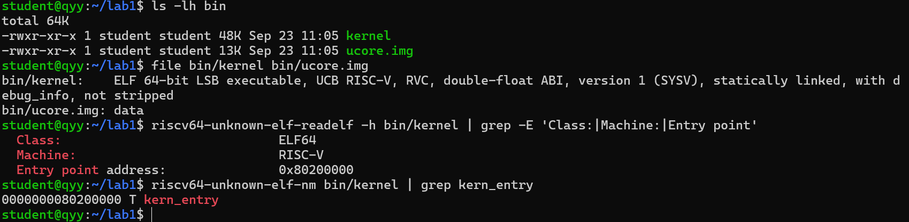

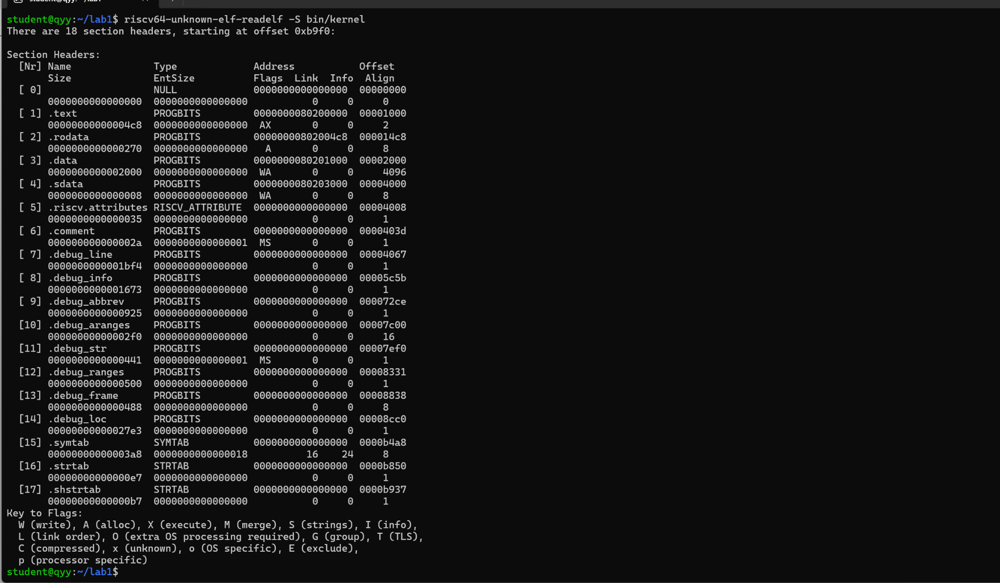

这说明链接脚本、ELF 入口和关键符号地址相互一致。

---

### 4.2 内核入口与启动流程验证

内核最早执行的代码位于 `kern/init/entry.S`：

```asm
kern_entry:
    la sp, bootstacktop
    tail kern_init
```

其中：

- `la sp, bootstacktop` 将内核栈顶地址写入 `sp`，为后续 C 函数调用建立运行环境；
- `tail kern_init` 将控制权从汇编入口转移到 C 语言内核入口 `kern_init`。

反汇编结果也能观察到最终跳转至 `kern_init`。

**【程浩轩实验结果】**

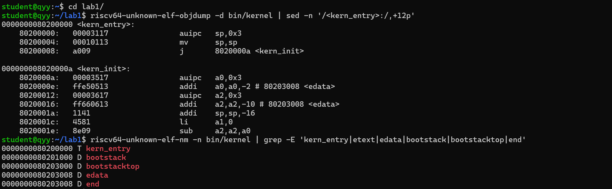

为了进一步验证 CPU 实际执行过程，使用 QEMU GDB Server 从机器加电阶段开始调试。

#### CPU 复位入口

GDB 刚连接 QEMU 时：

```gdb
info registers pc
x/8i $pc
```

得到：

```text
pc = 0x1000
```

说明 CPU 加电后并不是直接执行操作系统内核，而是首先执行 QEMU 提供的初始启动代码。

**【徐子恩实验结果】**

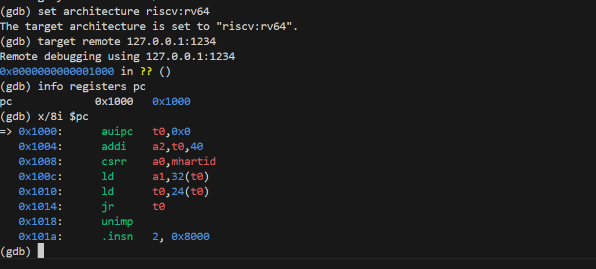

#### 进入 OpenSBI

在 `0x80000000` 设置断点：

```gdb
b *0x80000000
continue
```

观察到：

```text
pc = 0x80000000
```

说明 CPU 已进入 OpenSBI 固件。

**【徐子恩实验结果】**

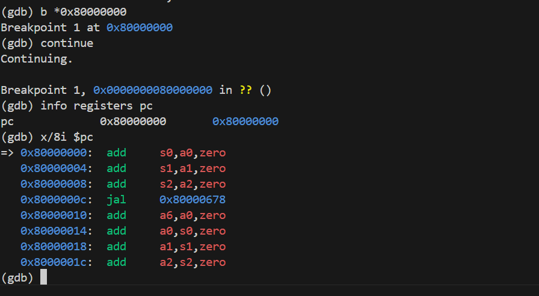

#### 进入 uCore 内核

继续在 `0x80200000` 设置断点：

```gdb
b *0x80200000
continue
```

GDB 命中：

```text
kern_entry () at kern/init/entry.S
pc = 0x80200000
```

同时：

```gdb
info address kern_entry
```

得到：

```text
kern_entry = 0x80200000
```

**【徐子恩实验结果】**

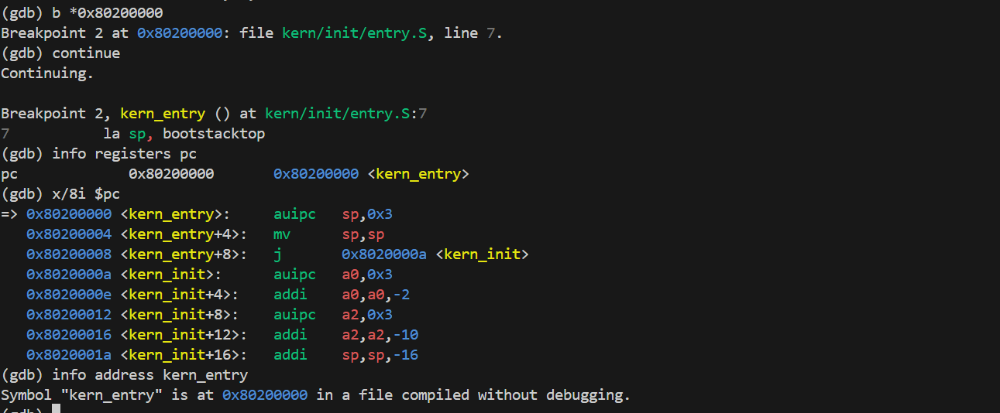

继续进入 `kern_init` 后观察到：

```text
sp = 0x80203000
```

与静态分析得到的：

```text
bootstacktop = 0x80203000
```

完全一致，因此证明 `la sp, bootstacktop` 已成功建立内核启动栈。

最终启动过程可概括为：

```text
0x1000
CPU 复位入口
    ↓
0x80000000
OpenSBI
    ↓
0x80200000
kern_entry
    ↓
sp = 0x80203000
    ↓
kern_init
```

---

### 4.3 QEMU/OpenSBI 启动兼容性问题

实验过程中，原始 Makefile 使用：

```text
-device loader,file=bin/ucore.img,addr=0x80200000
```

在部分实验环境下可以启动 OpenSBI，但出现：

```text
Domain0 Next Address : 0x0000000000000000
```

【胡家华实验结果】

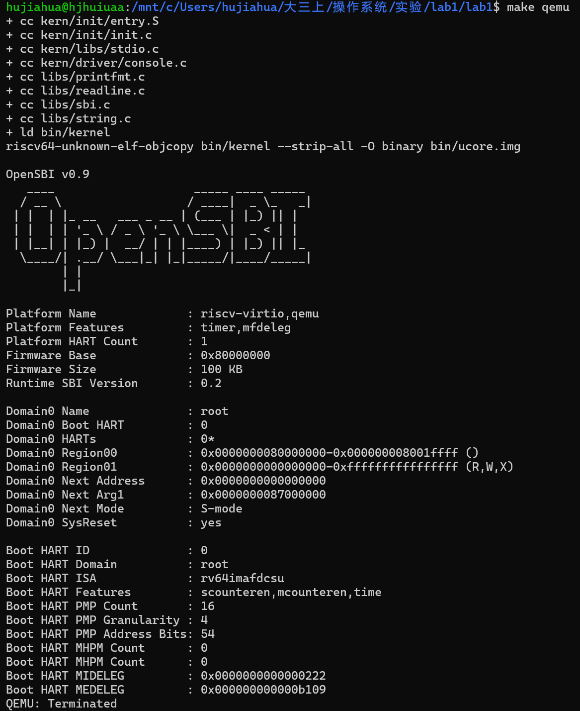

此时内核并未真正开始执行。

改为：

```bash
qemu-system-riscv64 \
    -machine virt \
    -nographic \
    -bios default \
    -kernel bin/ucore.img
```

后，OpenSBI 能够正确识别：

```text
Domain0 Next Address : 0x80200000
Domain0 Next Mode    : S-mode
```

并成功输出：

```text
(THU.CST) os is loading ...
```

**【程浩轩实验结果】**

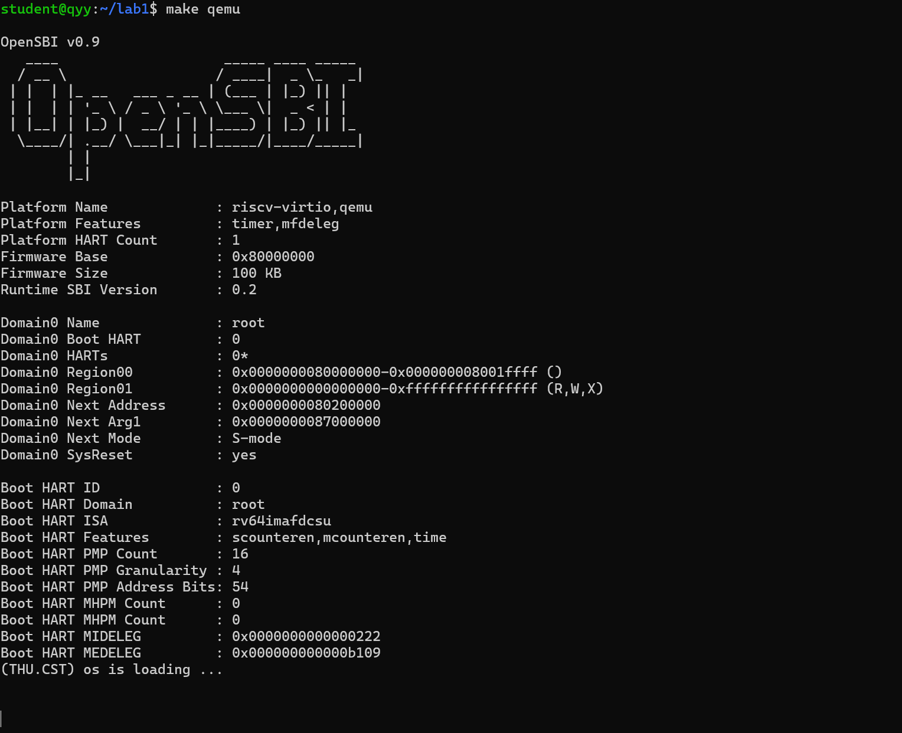

【胡家华实验结果】

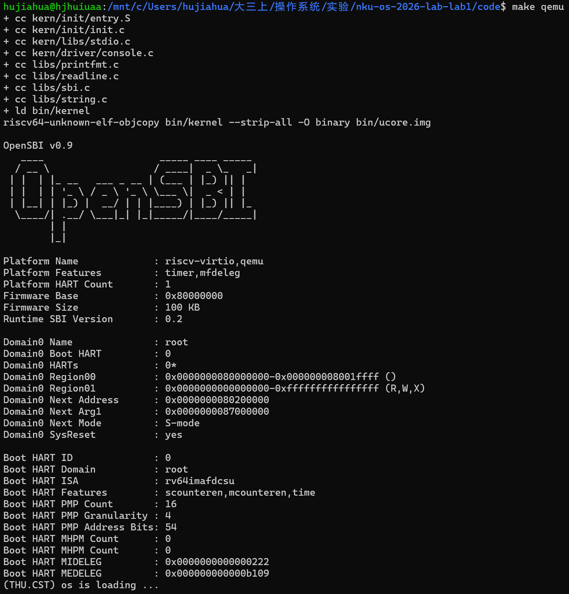

这一现象说明：**镜像被装入某个内存地址，并不意味着固件已经获得正确的下一执行入口。** 启动过程需要同时保证镜像位置和执行入口正确。

---

### 4.4 SBI 控制台输出验证

`kern_init` 中通过 `cprintf` 输出启动字符串，但 Lab1 尚未实现完整的串口驱动，因此字符最终通过 OpenSBI 提供的 SBI 服务输出。

核心调用链为：

```text
kern_init
    ↓
cprintf
    ↓
vprintfmt / cputch
    ↓
cons_putc
    ↓
sbi_console_putchar
    ↓
sbi_call
    ↓
ecall
    ↓
OpenSBI
    ↓
控制台
```

静态分析能够确认源码调用链，并在最终机器指令中找到 `ecall`。

**【程浩轩实验结果】**

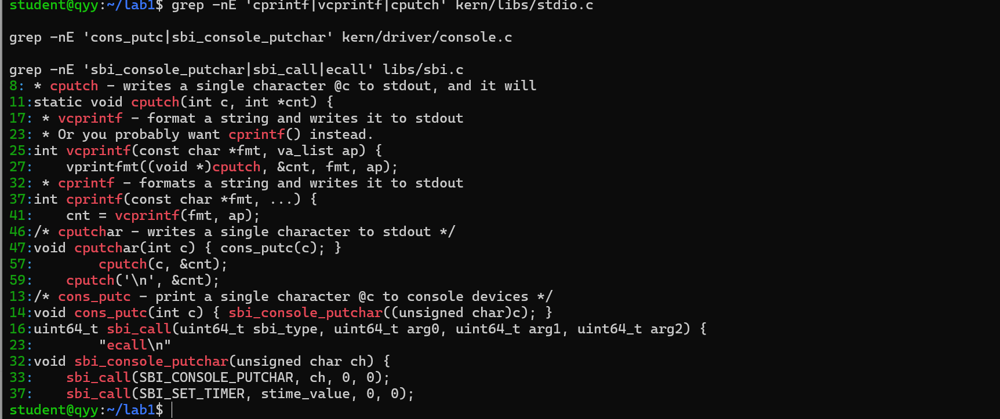

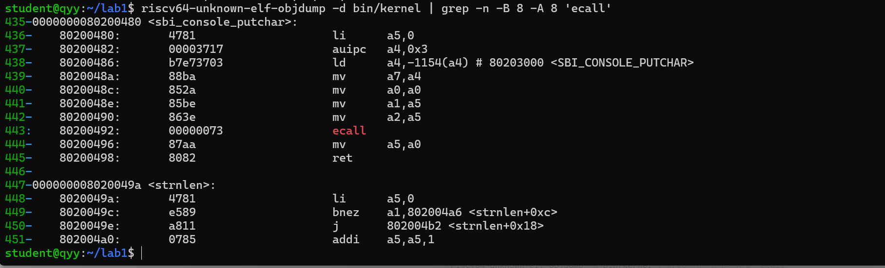

进一步使用 GDB 在 `ecall` 前观察寄存器。

实验中首先在 `sbi_console_putchar` 观察到：

```text
ch = 40 '('
```

说明启动字符串已经被拆分为单个字符进行输出。

另一组动态调试中，在 `ecall` 前实际观察到：

```text
pc = 0x80200478
a0 = 0x54 = 84 = 'T'
a1 = 0
a2 = 0
a7 = 1
```

**【徐子恩实验结果】**

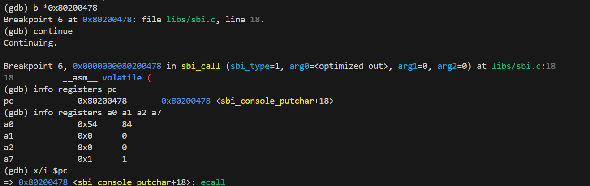

其中：

- `a0 = 0x54`：当前待输出字符 `'T'`；
- `a7 = 1`：SBI Console Putchar 服务号；
- 当前指令为 `ecall`，表示向 OpenSBI 请求控制台输出服务。

程浩轩的实验中首次捕获的字符为 `'('`，徐子恩实验中捕获到字符 `'T'`。虽然两次断点命中的具体字符以及机器指令地址不同，但都验证了同一个机制：

```text
a0 → 字符参数
a7 → SBI 服务号
ecall → 请求 OpenSBI 服务
```

---

### 4.5 实验结果总结

通过 Lab1 可以确认完整的最小内核执行链：

```text
源码
    ↓
交叉编译与链接
    ↓
bin/kernel / bin/ucore.img
    ↓
CPU 从 0x1000 启动
    ↓
OpenSBI 0x80000000
    ↓
kern_entry 0x80200000
    ↓
建立内核栈
    ↓
kern_init
    ↓
SBI ecall
    ↓
控制台输出
```

静态工具验证了内核的链接地址、符号和机器指令；GDB 则进一步验证了 CPU 实际运行时的 `pc`、`sp` 和 SBI 参数寄存器。两者结合，使内核启动过程从源码分析形成了完整的运行验证闭环。

### 最终提示词

本实验中用于辅助分析和调试的核心提示词概括如下：

```markdown
请结合当前 RISC-V uCore Lab1 源码和实际终端输出，
分析最小内核从编译、链接到 QEMU/OpenSBI 启动的完整过程。

重点：
1. 分析 kernel.ld、kern_entry 和 0x80200000 的关系。
2. 解释 la sp, bootstacktop 和 tail kern_init 的作用。
3. 使用 GDB 跟踪 0x1000 → 0x80000000 → 0x80200000 的启动过程。
4. 分析 cprintf 到 SBI ecall 的控制台输出链路。
5. 在 ecall 前观察 a0、a7 等寄存器并解释参数含义。
6. 所有结论尽量通过 readelf、nm、objdump 或 GDB 实际结果验证。
```

## 五、测试与验证

本实验的详细实现过程、静态分析和 GDB 调试过程已经在第四部分中给出。本节不再重复实验步骤，只选取具有代表性的结果对 Lab1 的最终运行情况进行验证。

### 5.1 内核入口验证

通过 ELF 信息可以确认最终生成内核的入口地址为：

```text
Entry Point = 0x80200000
```

同时 `kern_entry` 的符号地址也为：

```text
kern_entry = 0x80200000
```

**【程浩轩实验结果】**


该结果说明链接脚本中指定的内核入口与最终生成的 ELF 文件保持一致。

---

### 5.2 内核启动验证

QEMU/OpenSBI 启动后可以观察到：

```text
Domain0 Next Address : 0x80200000
Domain0 Next Mode    : S-mode
```

随后内核正常输出：

```text
(THU.CST) os is loading ...
```

**【程浩轩实验结果】**


说明 OpenSBI 已经成功将控制权交给位于 `0x80200000` 的 uCore 内核，并正常执行 `kern_init`。

---

### 5.3 GDB 动态验证

在 GDB 调试中，从 CPU 加电开始实际观察到的启动路径为：

```text
0x1000
    ↓
0x80000000
OpenSBI
    ↓
0x80200000
kern_entry
    ↓
sp = 0x80203000
    ↓
kern_init
```

该结果与链接脚本、ELF 地址以及 `entry.S` 中的启动逻辑一致。

继续跟踪 SBI 控制台输出，在 `ecall` 执行前观察到：

```text
a0 = 0x54 = 'T'
a1 = 0
a2 = 0
a7 = 1
```

**【徐子恩实验结果】**


其中：

- `a0` 保存当前需要输出的字符；
- `a7 = 1` 表示 SBI Console Putchar 服务；
- 随后的 `ecall` 将控制台输出请求交给 OpenSBI。

这说明从内核 `cprintf` 到 SBI `ecall` 的输出链路能够正常工作。

---

### 5.4 测试结果汇总


| 验证项目            | 实验结果                                |
| --------------- | ----------------------------------- |
| 内核编译与镜像生成       | 成功生成 `bin/kernel` 和 `bin/ucore.img` |
| ELF 内核入口        | `0x80200000`                        |
| `kern_entry` 地址 | `0x80200000`                        |
| OpenSBI 下一执行地址  | `0x80200000`                        |
| 内核运行模式          | S-mode                              |
| CPU 初始执行位置      | `0x1000`                            |
| OpenSBI 执行位置    | `0x80000000`                        |
| 内核栈初始化          | `sp = 0x80203000`                   |
| C 语言内核入口        | 成功进入 `kern_init`                    |
| SBI 控制台输出       | 成功执行 `ecall` 并正常输出启动字符串             |


### 5.5 测试结论

综合静态分析、QEMU/OpenSBI 运行结果和 GDB 动态调试结果，本实验成功验证了：

```text
CPU 启动
    ↓
OpenSBI
    ↓
uCore 内核
    ↓
建立内核栈
    ↓
kern_init
    ↓
SBI ecall
    ↓
控制台输出
```

内核的链接地址、实际运行地址和动态执行过程能够相互对应，Lab1 的最小内核启动及基本输出功能均正常完成。

## 六、实验总结与收获

### 练习一：

1. la sp,bootstacktop ：将 bootstacktop 的地址赋值给sp寄存器，初始化栈并把sp指向栈顶。
2. tail kern_init：使用尾调用直接跳转到kern_init，进入内核入口。

### 对操作系统的理解：

#### 1. 本实验中重要的知识点及其与 OS 原理的关系

**（1）链接脚本与操作系统内存布局**

本实验通过 `kernel.ld` 明确指定内核从 `0x80200000` 开始，并依次组织 `.text`、`.rodata`、`.data`、`.bss` 等段。链接脚本解决的是“程序在最终地址空间中如何排列”的问题；OS 原理中的内存管理则进一步涉及虚拟地址、页表、地址转换和保护。本实验展示的是较早阶段的静态布局，还没有进入完整的虚拟内存管理。

**（2）ELF 与内核镜像**

`bin/kernel` 是包含 ELF Header、符号表和调试信息的 ELF 可执行文件，适合 `readelf`、`nm`、`objdump` 和 GDB 分析；`bin/ucore.img` 则通过 `objcopy -O binary` 得到，更接近 QEMU 直接加载的裸镜像。二者对应“程序结构信息”和“实际加载内容”两个不同层次。

**（3）内核启动与特权级**

OpenSBI 在固件层完成底层初始化，并将控制权交给 `0x80200000` 的 S-mode 内核。Lab1 通过 `Domain0 Next Mode = S-mode` 直接展示了 RISC-V 特权级在操作系统启动中的作用。操作系统内核通常运行在 S-mode，而 OpenSBI 提供 M-mode 固件服务。

**（4）内核栈与函数调用基础**

进入 C 函数前必须先建立有效栈。`la sp, bootstacktop` 体现了操作系统启动代码必须主动建立运行环境；这与普通应用由运行时环境准备栈不同。GDB 中 `sp` 变为 `0x80203000` 说明这一过程确实生效。

**（5）SBI ecall 与系统调用 ecall 的联系和区别**

二者都使用 RISC-V 的 `ecall` 指令请求更高特权级提供服务，但调用方向不同：Lab1 中 SBI 调用主要是 S-mode 内核请求 M-mode OpenSBI 服务；典型用户态系统调用则是 U-mode 程序请求 S-mode 内核服务。因此“指令相同”并不意味着“接口层次相同”。

**（6）静态分析与动态调试**

`readelf/nm/objdump` 用于查看最终二进制的静态结构，GDB 用于观察运行时 `pc`、`sp` 和参数寄存器。只有将两者结合，才能较完整地证明链接地址、机器指令和 CPU 实际执行行为是一致的。

#### 2. OS 原理中重要但本实验尚未对应的知识点

Lab1 主要关注最小内核启动，因此下列重要 OS 知识点尚未真正展开：

1. **中断、异常与 Trap 处理**：尚未建立完整的 trap 向量和统一异常处理流程。
2. **虚拟内存与页表**：尚未构造页表，也没有实现虚拟地址到物理地址的映射、页权限和缺页处理。
3. **进程/线程与调度**：没有进程控制块、上下文切换、调度算法和生命周期管理。
4. **用户态与系统调用**：虽然本实验出现了 `ecall`，但这是 SBI 调用，不是完整的 U-mode → S-mode 系统调用机制。
5. **同步与并发**：没有锁、信号量、条件变量及多核并发控制。
6. **文件系统与设备管理**：控制台输出借助 OpenSBI，尚未实现完整设备驱动和文件抽象。
7. **内核动态内存管理**：尚未涉及页分配器、堆分配或内核对象管理。

### AI 协作开发的经验

#### 2411102-程浩轩

本次实验中，AI 最有价值的作用不是直接生成大量代码，而是帮助把实验拆分成“环境 → 编译 → 链接 → 启动 → 静态分析 → 动态验证”几个可以逐步确认的阶段。实际使用中得到以下经验：

1. **Prompt 应包含真实环境和输出，而不能只描述现象。** 例如 QEMU 启动失败时，将 QEMU 版本、OpenSBI 输出和 `Domain0 Next Address = 0` 一并提供，比只询问“为什么没有输出”更容易定位问题。
2. **AI 给出的结论必须通过工具验证。** 本实验使用 `readelf` 验证 Entry Point、`nm` 验证符号、`objdump` 验证机器指令，再使用 GDB 验证运行状态，避免只依据语言解释下结论。
3. **优先做最小修改。** 当内核没有运行时，没有直接重写 `entry.S` 或 `init.c`，而是先定位到 QEMU 启动参数与当前环境的兼容问题，只调整 Makefile 启动方式。
4. **将聊天式提问逐步专业化。** 后期提示词明确了目标、依赖文件、验证手段和预期结果，使 AI 输出更可复现，也更符合实验报告对 Prompt 过程的要求。
5. **保留失败过程同样重要。** 从 `Domain0 Next Address = 0` 到改用 `-kernel` 成功的过程能够体现问题定位能力，比只保留最终成功截图更能说明实验理解。

#### [2411112-徐子恩]]

本次实验中，AI 主要用于梳理内核启动流程、辅助分析 GDB 调试结果以及定位 QEMU/OpenSBI 启动问题。实验过程中，我通过实际观察 `0x1000 → 0x80000000 → 0x80200000` 的启动过程，以及 `ecall` 前的寄存器状态，对 AI 给出的分析进行验证。

通过本次实验，我认识到 AI 更适合作为调试和分析辅助工具，最终结论仍需要结合源码、反汇编结果和实际运行现象进行确认。

#### [2410935-胡家华]

本次实验的代码量不大，大模型主要用于生成回答，包括对指导书知识点的梳理、对实验代码的解释等。在实验过程中，我向大模型询问了markdown文件的编辑方法，在qemu启动出现错误时，我结合实际的输出，利用AI分析并解决了问题。

后续实验中，AI协作开发的重心可能要转向代码的生成，我会在与AI交互时尝试使用标准化的提示词结构，获得更高质量的代码和回复。

---

