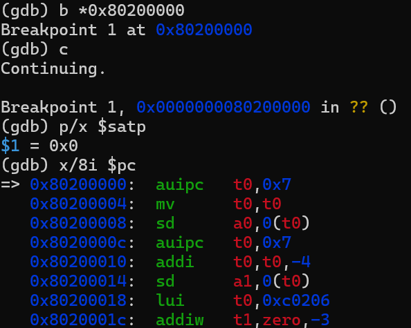
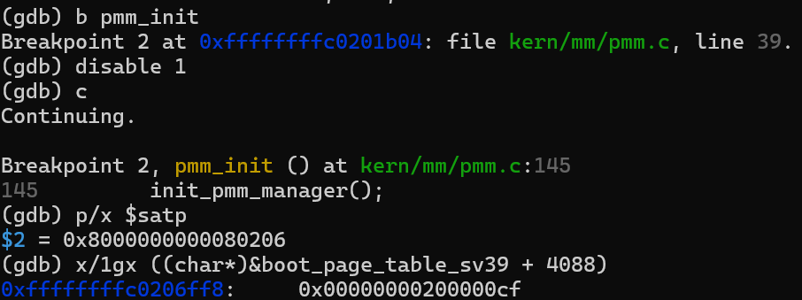
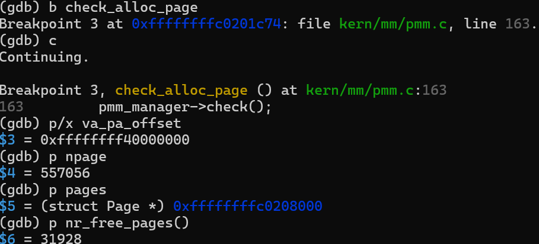

# 操作系统实验二：物理内存与页表——实验报告

> 小组成员：2411102-程浩轩，2411112-徐子恩，2410935-胡家华 实验环境：Windows + WSL Ubuntu、RISC-V GCC、QEMU、Git/GitHub 提交分支：`lab2`

## 一、实验目的

本实验的主要目的是：

1. 理解 uCore 在启动阶段如何探测物理内存、建立 `Page` 描述符并登记可用页。
2. 理解 First-Fit 连续物理内存分配器的空闲块初始化、分配、释放和相邻块合并过程。
3. 在 First-Fit 框架基础上实现 Best-Fit 分配器，并通过 AI 辅助完成代码设计、调试和测试。
4. 从零实现 Buddy System，按 2 的幂管理空闲块，并编写自测。
5. 实现简化 SLUB，在页分配器之上完成任意大小对象分配，并使用 GDB 观察启动页表与 `satp`。

---

## 二、实验环境

实验继续使用 Lab1 已配置的 WSL Ubuntu 环境，工具包括 `riscv64-unknown-elf-gcc`、`qemu-system-riscv64`、Git/GitHub，以及终端中的 AI 编程工具。代码仓库的目标分支为 `lab2`。


| 成员          | AI 编程工具    | 底层模型     | 备注                                 |
| ----------- | ---------- | -------- | ---------------------------------- |
| 2411102-程浩轩 | 终端 AI 编程工具 | GPT-5    | 用于 `page_init()` 和 First-Fit 分析    |
| 2411112-徐子恩 | chatgpt    | GPT-5.6  | 用于 Best-Fit 模块实现与调试                |
| 2410935-胡家华 | cursor     | Grok 4.6 | 用于实现Buddy System、SLUB功能，并辅助进行GDB调试 |


重要文件如下：


| 文件                                  | 作用                                    |
| ----------------------------------- | ------------------------------------- |
| `kern/driver/dtb.c`、`dtb.h`         | 获取设备树提供的物理内存起点和大小                     |
| `kern/mm/pmm.c`                     | 组织内存管理器初始化、`page_init()`、分配测试         |
| `kern/mm/pmm.h`、`memlayout.h`       | 定义 `Page`、`pmm_manager`、地址转换函数和内存范围常量 |
| `kern/mm/default_pmm.c`             | 原有 First-Fit 分配器及测试                   |
| `kern/mm/best_fit_pmm.c`            | Best-Fit 实现文件                         |
| `kern/mm/buddy_pmm.c`、`buddy_pmm.h` | Buddy System 分配器与自测                   |
| `kern/mm/slub.c`、`slub.h`           | 简化 SLUB 对象分配器与自测                      |
| `kern/init/entry.S`                 | 启动入口及早期页表相关代码                         |
| `Makefile`                          | 编译、QEMU 启动和 GDB 调试规则                  |


---

## 三、实验整体逻辑分析

### 3.1 本章节的逻辑主线

本章围绕“如何在 uCore 中管理连续物理页”展开。内核启动后，首先需要由 `page_init()` 获取设备树中的物理内存范围，建立 `Page` 描述符数组，并排除内核和描述符本身占用的区域。随后，物理内存管理器把剩余页组织为空闲块，向上层提供连续页的分配与释放接口。实验先通过阅读完整的 First-Fit 实现理解空闲链表、页属性和相邻块合并，再在相同接口上实现 Best-Fit，并切换内核实际使用的管理器。之后从零实现 Buddy System 与简化 SLUB：前者按 2 的幂拆分和合并物理页，后者在页分配器之上切分小对象。最后通过内置检查、GDB 观察启动页表，以及评分脚本验证实现。

### 3.2 功能的逐步实现

1. 首先完成物理内存初始化，确定 `Page` 数组和真正可分配的物理页范围；这是后续所有分配器工作的基础。
2. 接着阅读 `default_pmm.c`，理解 First-Fit 如何登记、分配、回收和合并空闲块。
3. 然后根据 `pmm_manager` 接口实现 Best-Fit，遍历所有候选块并选择最小的满足块。
4. 然后把 `best_fit_pmm_manager` 注册到 `pmm.c`，确认 Best-Fit 源文件参与构建，并运行内核检查和 `make grade`。
5. 接着实现 Buddy System：按阶维护空闲链表，完成拆分、伙伴合并和自测，且不替换默认的 Best-Fit 管理器。
6. 再实现简化 SLUB：用 `alloc_page()` 获得物理页，按大小分档切成对象；空 slab 归还页分配器。
7. 最后用 GDB 连接 `make debug` 启动的内核，核对 `satp`、启动页表项以及 `page_init()` 之后的内存全局量。

---

## 四、实验内容与实现

### 4.1 组员分工与代码结构


| 成员          | 负责的练习/模块                                    |
| ----------- | ------------------------------------------- |
| 2411102-程浩轩 | `page_init()` 物理内存探测和页描述符初始化；First-Fit 原理分析 |
| 2411112-徐子恩 | Best-Fit 连续物理内存分配算法                         |
| 2410935-胡家华 | Buddy System、简化 SLUB、GDB调试                  |


整体流程为：

```text
QEMU/OpenSBI 启动 → kern_entry → kern_init()
                                  ↓
                            pmm_init()
                                  ↓
                        init_pmm_manager()
                                  ↓
       page_init()：获取内存信息、建立 Page 数组、注册空闲页
                                  ↓
          check_alloc_page()：调用分配器自己的 check()
                                  ↓
          后续分配器实验：First-Fit → Best-Fit → Buddy System → SLUB
                                  ↓
                     GDB：观察 satp 与 boot_page_table_sv39
```

### 4.2 功能模块一：物理内存初始化功能

**任务一：实现物理内存探测与页描述符初始化功能。**

#### 任务要求与设计思路

实现 `kern/mm/pmm.c` 中的 `static void page_init(void)`，依据设备树信息建立物理页面描述符布局，并将排除了 OpenSBI、内核和描述符数组占用区域之后的完整空闲页交给当前 `pmm_manager`。函数不需要传参或返回值；正常完成后应正确设置 `va_pa_offset`、`npage`、`pages` 等全局量。

思路是：先取物理内存范围并验证合法性，再确定允许管理的内存上界，设置内核虚拟地址到物理地址的偏移；随后在内核末尾之后按页对齐放置 `Page` 数组，用它记录物理页状态。描述符占用的空间也不能再分配，所以将其末尾向上对齐，作为真正空闲空间的起点。最后把这些空闲页交给 `init_memmap()`。

#### 关键代码及理解

实现位置是 `pmm.c` 中原有的 `//lab2 function1 YOUR CODE` 标记处。实际使用的主要接口有 `get_memory_base()`、`get_memory_size()`、`panic()`、`PADDR()`、`pa2page()` 和 `init_memmap()`。

**（1）探测和限制物理内存范围**

```c
uint64_t mem_base = get_memory_base();
uint64_t mem_size = get_memory_size();

if (mem_size == 0 || mem_base != DRAM_BASE ||
    mem_size > ((uint64_t)-1) - mem_base) {
    panic("invalid physical memory information");
}

uint64_t mem_end = mem_base + mem_size;
if (mem_end > PHYSICAL_MEMORY_END) {
    mem_end = PHYSICAL_MEMORY_END;
}
```

这里不能直接把设备树读到的大小当成全部可用内存。程序先排除零大小、当前内核布局不支持的内存起点和加法溢出，再根据本实验的可管理上界限制 `mem_end`。`mem_base == DRAM_BASE` 是这一版代码针对当前 QEMU 内存布局采用的限制，并不是所有硬件设备都必须满足的通用条件。

**（2）设置页面范围与描述符数组**

```c
va_pa_offset = PHYSICAL_MEMORY_OFFSET;
npage = PPN(mem_end);
pages = (struct Page *)ROUNDUP((uintptr_t)end, PGSIZE);
size_t page_count = npage - nbase;
```

`va_pa_offset` 用于完成内核虚拟地址和物理地址的转换；`npage` 在这个框架中是物理页号上界，`pages` 是描述符数组的虚拟地址。需要特别注意：`Page` 并不是一页实际数据，它保存的是该物理页的引用计数、状态标志和空闲块信息。`page_count` 才是这份描述符数组要覆盖的页数。

**（3）计算空闲页范围**

```c
uintptr_t metadata_start = PADDR(pages);
uintptr_t metadata_size = page_count * sizeof(struct Page);
uintptr_t free_start = ROUNDUP(metadata_start + metadata_size, PGSIZE);
uintptr_t free_end = ROUNDDOWN(mem_end, PGSIZE);
```

描述符数组也需要占内存，因此不能把 `end` 后面的空间直接视为全部空闲页。必须先跳过 `Page` 数组，再做页对齐。实际代码还检查了描述符空间不足和没有完整空闲页的情况，对不符合要求的情形执行 `panic()`。

**（4）初始化保留页并注册空闲页**

```c
for (size_t i = 0; i < page_count; i++) {
    pages[i].flags = 0;
    pages[i].property = 0;
    set_page_ref(&pages[i], 0);
    SetPageReserved(&pages[i]);
}

size_t free_count = (free_end - free_start) / PGSIZE;
init_memmap(pa2page(free_start), free_count);
```

先把所有描述符标记为保留，确保不能误分配给其他代码；然后由当前管理器的 `init_memmap()` 将真正可用的区域改成空闲状态，并放入其管理结构。当前采用的是 `default_pmm_manager`，也就是 First-Fit 实现。

> 说明：以上摘录的是本次实际编写逻辑中的关键语句，不是全部函数。完整实现以 GitHub `lab2` 分支中的 `kern/mm/pmm.c` 为准；正式提交前应将标记中的 `YOUR CODE` 按指导书要求替换为组员 A 的学号，并保留 `lab2` 注释。

### 4.3 Challenge：硬件的可用物理内存范围获取方法

如果操作系统无法预先知道硬件的可用物理内存范围，可以在启动阶段通过固件或硬件提供的描述信息获取。RISC-V uCore 当前使用设备树接口读取内存节点中的起始地址和长度；在其他平台上，也可以使用 BIOS/UEFI 提供的内存映射、固件接口或 ACPI 的内存表。操作系统拿到这些区域后，还要扣除固件、内核、页表、设备映射和页描述符数组占用的范围，并按页对齐后交给物理内存管理器。这样做比假定固定地址范围更适合不同硬件配置，也能避免把保留区域误当作可分配内存。

### 4.4 功能模块二：First-Fit 连续物理内存分配算法

**任务一：理解 First-Fit 连续物理内存分配算法。**

#### 整体数据结构

`default_pmm.c` 使用 `free_area_t free_area` 保存空闲链表 `free_list` 与空闲页计数 `nr_free`。`Page` 结构中的 `property` 保存连续空闲块的页数，`PG_property` 标志表明该 `Page` 是空闲块头部。

空闲链表中的每个节点只对应一个连续空闲块的首页。比如一个块包含 8 个页面，只有第一个 `Page` 挂入 `free_list`，并令其 `property = 8`；其余页面不作为独立节点。这样既能表示连续范围，也能让分裂和合并只修改块头及链表关系。

#### 核心函数理解

- `default_init()`**（第 11～15 行）**：初始化链表头并把空闲页数量清零。
- `default_init_memmap()`**（第 17～43 行）**：清除待管理页的保留状态、设置首个页的 `property=n`，按物理页地址顺序插入空闲链表。
- `default_alloc_pages()`**（第 45～73 行）**：从链表头开始寻找第一个 `property >= n` 的空闲块。若块比所需大，则将剩余部分分裂成新空闲块；分配完成后减少 `nr_free`。
- `default_free_pages()`**（第 75～123 行）**：释放连续页面，按地址顺序插入链表，并分别检查前后相邻块是否能够合并。
- `default_nr_free_pages()`**（第 125～128 行）**：返回空闲物理页数量。
- `basic_check()`**、**`default_check()`**（第 130～244 行）**：测试分配、回收、连续块分裂与合并及页数一致性。按指导书要求不修改它们。

初始化时，`default_init_memmap()` 先清除每个页面的保留状态和旧属性，再把整个区域登记为一个块：

```c
for (p = base; p != base + n; p ++) {
    assert(PageReserved(p));
    p->flags = p->property = 0;
    set_page_ref(p, 0);
}
base->property = n;
SetPageProperty(base);
nr_free += n;
```

随后按页面地址顺序把 `base` 插入 `free_list`。因此初始化完成后，链表描述的是所有可分配的连续区间，而 `nr_free` 是这些区间长度之和。

分配时，First-Fit 从链表头向后遍历，遇到第一个满足 `p->property >= n` 的块就停止：

```c
while ((le = list_next(le)) != &free_list) {
    struct Page *p = le2page(le, page_link);
    if (p->property >= n) {
        page = p;
        break;
    }
}
if (page != NULL) {
    list_entry_t *prev = list_prev(&page->page_link);
    list_del(&page->page_link);
    if (page->property > n) {
        struct Page *rest = page + n;
        rest->property = page->property - n;
        SetPageProperty(rest);
        list_add(prev, &rest->page_link);
    }
    nr_free -= n;
    ClearPageProperty(page);
}
```

这里的关键是“取走块头、必要时从块尾分裂剩余区间”。分配返回的 `page` 不再带有 `PG_property`，而剩余块的新首页面获得该标志。

释放时，`default_free_pages()` 先把待释放区间按地址插入链表，再检查前后节点：若前块末尾正好等于当前块起始地址，就把当前块长度加到前块；随后若当前块末尾正好等于后块起始地址，也进行合并。合并过程中只保留最终块首页的 `property` 和 `PG_property`，并删除被吸收块的链表节点。

#### 思考题：First-Fit 有没有改进空间？

我认为有。First-Fit 比较容易实现，遍历链表时找到第一个满足大小的空闲块就分配；但空闲块多了以后查找可能变慢，反复分配与释放也可能造成外部碎片。原实现已经通过合并前后相邻空闲块减少碎片，但不能保证完全消除。可以考虑 Best-Fit 或 Buddy System 等方案：Best-Fit 选择更接近请求大小的块，但可能留下难以利用的小块；Buddy System 更方便按固定阶数分裂和合并，但也可能带来内部碎片，不能说一定全面优于 First-Fit。

### 4.5 功能模块二：Best-Fit 连续物理内存分配算法

**任务二：实现 Best-Fit 连续物理内存分配算法。**

**负责人：** 2411112-徐子恩

#### 任务要求与设计思路

本任务在现有 uCore 物理内存管理框架上实现 Best-Fit 连续物理页分配器，并将其注册为内核实际使用的 `pmm_manager`。任务一要求阅读 `kern/mm/default_pmm.c`，理解 First-Fit 的初始化、分配、释放和相邻空闲块合并过程；前面的章节已保留相关原理及 First-Fit 分析，本节重点说明 Best-Fit 的实现。

Best-Fit 与 First-Fit 使用相同的页描述符和管理接口，但选择空闲块的规则不同。First-Fit 从空闲链表头开始，遇到第一个容量不少于申请页数的空闲块就停止；Best-Fit 则检查所有空闲块，并从满足 `property >= n` 的候选块中选择 `property` 最小者。这样可以优先使用最接近申请大小的空闲块，减少大块空间被小请求占用的情况，但不保证在所有工作负载下都能减少碎片。

实现沿用框架中 `struct pmm_manager` 的接口，并在 `kern/mm/best_fit_pmm.c` 中维护空闲链表和空闲页计数。空闲块头部的 `Page.property` 记录该连续块包含的页数，`PG_property` 标志用于识别空闲块头部；块内其余页面不单独登记为链表节点。该设计与原有 First-Fit 框架一致，能够复用现有的 `alloc_pages()`、`free_pages()` 等上层调用。

#### 核心函数与代码

涉及的核心函数和对象为：

```c
static void best_fit_init(void);
static void best_fit_init_memmap(struct Page *base, size_t n);
static struct Page *best_fit_alloc_pages(size_t n);
static void best_fit_free_pages(struct Page *base, size_t n);
static size_t best_fit_nr_free_pages(void);
const struct pmm_manager best_fit_pmm_manager;
```

Best-Fit 模块实现了以下管理函数，并通过 `best_fit_pmm_manager` 对外注册：


| 函数/对象                                              | 作用                               |
| -------------------------------------------------- | -------------------------------- |
| `best_fit_init()`                                  | 初始化空闲链表和空闲页计数。                   |
| `best_fit_init_memmap()`                           | 将传入的连续页面初始化为一个空闲块，并登记块大小。        |
| `best_fit_alloc_pages(size_t n)`                   | 搜索所有空闲块，选择满足申请大小且最小的块；必要时拆分剩余空间。 |
| `best_fit_free_pages(struct Page *base, size_t n)` | 回收连续页面，将其重新加入空闲链表，并合并地址相邻的空闲块。   |
| `best_fit_nr_free_pages()`                         | 返回当前空闲页总数。                       |
| `best_fit_pmm_manager`                             | 将上述函数与框架的 `pmm_manager` 接口连接起来。  |


分配过程的核心是遍历所有候选块并记录最小满足块，其逻辑可概括为：

```c
best = NULL;
for (each free block p) {
    if (p->property >= n &&
        (best == NULL || p->property < best->property)) {
        best = p;
    }
}
```

实际代码中，管理器先处理申请大于总空闲页数的情况，再遍历链表；找到 `best` 后先保存其前驱节点并删除原块，若需要分裂，则把 `best + n` 作为剩余块重新插回原位置附近：

```c
if (n > nr_free) {
    return NULL;
}
struct Page *best = NULL;
list_entry_t *le = &free_list;
while ((le = list_next(le)) != &free_list) {
    struct Page *page = le2page(le, page_link);
    if (page->property >= n &&
        (best == NULL || page->property < best->property)) {
        best = page;
    }
}
if (best == NULL) {
    return NULL;
}
list_entry_t *prev = list_prev(&best->page_link);
list_del(&best->page_link);
if (best->property > n) {
    struct Page *remainder = best + n;
    remainder->property = best->property - n;
    SetPageProperty(remainder);
    list_add(prev, &remainder->page_link);
}
nr_free -= n;
ClearPageProperty(best);
return best;
```

以上为算法逻辑示意，实际实现以 `kern/mm/best_fit_pmm.c` 中的代码为准。找到候选块后，如果块大小恰好等于申请页数，则直接取走该块；如果块更大，则把剩余部分登记为新的空闲块。分配和释放都同步更新 `nr_free`，并维护 `Page.property`、`PG_property` 和链表节点状态，避免已分配页面仍被当作空闲块头部。

释放页面时，分配器把页面重新插入空闲链表，并检查前后相邻块的物理地址是否连续。若连续，就合并为一个更大的空闲块，同时把 `property` 设置在合并后块的首页面。合并只能发生在地址连续的空闲块之间，不能跨越中间的已分配页面。

释放前，代码会逐页清除旧状态并恢复引用计数；释放区间插入后，前向合并和后向合并分别使用指针加上块长度判断物理连续性：

```c
if (prev + prev->property == base) {
    prev->property += base->property;
    ClearPageProperty(base);
    list_del(&base->page_link);
    base = prev;
}
if (base + base->property == next) {
    base->property += next->property;
    ClearPageProperty(next);
    list_del(&next->page_link);
}
```

最后，`best_fit_pmm_manager` 将这些函数接入统一接口，`pmm.c` 中的 `init_pmm_manager()` 再把全局管理器指针切换到它：

```c
const struct pmm_manager best_fit_pmm_manager = {
    .name = "best_fit_pmm_manager",
    .init = best_fit_init,
    .init_memmap = best_fit_init_memmap,
    .alloc_pages = best_fit_alloc_pages,
    .free_pages = best_fit_free_pages,
    .nr_free_pages = best_fit_nr_free_pages,
    .check = best_fit_check,
};
```

除实现分配器本身外，还完成了两项接入工作：在 `kern/mm/pmm.c` 的 `init_pmm_manager()` 中将当前管理器切换为 `best_fit_pmm_manager`，使 `pmm_init()` 后续使用 Best-Fit；同时修改 `Makefile` 的源文件筛选规则，让 `kern/mm/best_fit_pmm.c` 参与内核编译。原有的 `basic_check()` 和 `best_fit_check()` 测试函数没有修改。

#### 思考题：Best-Fit 算法是否还有改进空间？

有。当前实现需要遍历空闲链表寻找最小满足块，若空闲块数量为 (F)，一次分配的搜索时间复杂度最坏为 (O(F))。对于本实验的内存规模，这种实现简单、容易检查，足以满足要求；但在空闲块很多的系统中，可以考虑按块大小建立有序树或分级空闲链表，以缩短查找时间。

此外，Best-Fit 并不能彻底消除外部碎片：多次分配可能留下许多很小、难以满足后续请求的空闲块。释放时合并物理地址相邻的空闲块有助于缓解这一问题。若同时需要快速按大小查找和快速按地址合并，可以维护按大小与按地址组织的辅助索引，但这会增加数据结构维护成本。因此，算法改进需要在搜索速度、碎片情况和实现复杂度之间权衡。

### 4.6 任务三：Buddy System 伙伴分配算法

**任务三：从零实现 Buddy System 分配模块并接入内核。**

#### 任务要求与设计思路

Buddy System 把空闲物理页按 2 的幂组织：块大小只能是 1、2、4、8、… 页。为每一阶维护一条空闲链表。申请 `n` 页时，先向上取到最小的 `2^k >= n`；若该阶没有空闲块，就从更高阶拆下一块，一半留下分配，一半挂回低一阶。释放时用页下标异或 `idx XOR 2^k` 找伙伴，只有伙伴同阶且空闲才合并。

本实验评分脚本仍检查 Best-Fit，因此默认 `pmm_manager` 保持为 `best_fit_pmm_manager`。Buddy 作为独立模块接入：Best-Fit 自检通过后，从当前分配器暂借 128 个连续页作为沙箱，切换到 `buddy_pmm_manager` 跑 `check`，再把页面归还 Best-Fit。这样既验证 Buddy，又不破坏 `make grade`。

新增文件为 `kern/mm/buddy_pmm.c` 和 `buddy_pmm.h`，在 `pmm_init()` 中于 `check_alloc_page()` 之后调用 `buddy_selftest()`。

#### 核心函数与代码


| 函数/对象                       | 作用                                           |
| --------------------------- | -------------------------------------------- |
| `buddy_init()`              | 初始化 `MAX_ORDER+1` 条空闲链表。                     |
| `buddy_init_memmap()`       | 把连续空闲区拆成地址对齐的 2 的幂块并挂入对应阶。                   |
| `buddy_alloc_pages(n)`      | 按 `order_of(n)` 取块，必要时从高阶拆分。                 |
| `buddy_free_pages(base, n)` | 按同样规则把 `n` 升成 2 的幂后释放，并尝试与伙伴合并。              |
| `buddy_nr_free_pages()`     | 返回当前空闲页数（按实际占用的 2 的幂统计）。                     |
| `buddy_selftest()`          | 向 Best-Fit 借沙箱、切换管理器、运行 `buddy_check()` 后归还。 |


申请 3 页会实际占用 4 页；`free_pages(p, 3)` 也必须按 4 页归还，否则伙伴关系会错位。分配核心可概括为：

```c
order = order_of(n);
cur = order;
while (cur 阶空闲链表为空) cur++;
block = 取出 cur 阶的一块;
while (cur > order) {
    cur--;
    把右半块挂回 cur 阶;
}
nr_free -= (1 << order);
return block;
```

伙伴计算与合并：

```c
buddy_idx = page_idx(base) ^ (1UL << order);
if (伙伴同阶且位于 Buddy 管理区内) {
    从该阶链表删除伙伴;
    base = min(base, buddy);
    order++;
}
把合并后的块挂入新的阶;
```

### **4.7 扩展C**hallenge：任意大小的内存单元 SLUB 分配算法

#### 任务要求与设计思路

SLUB 是两层分配器。第一层继续使用现有 `alloc_page()` / `free_page()`（Best-Fit）；第二层把拿到的物理页切成固定大小对象。本实现采用 8 档：16、32、64、128、256、512、1024、2048 字节。`slub_alloc(24)` 进入 32 字节档；大于 2048 或 `size==0` 返回 `NULL`。

每个 slab 占用一页：页首存放 `struct slub_slab`，其余空间按该档对象大小切开。空闲对象用自身前 8 字节串成 freelist。一页上 `inuse` 降到 0 时，把该页还给第一层。物理页通过 `page2pa(page) + va_pa_offset` 转成内核虚拟地址，与启动时 Sv39 把 `0x80000000` 映射到 `0xFFFFFFFFC0000000` 的布局一致。

新增 `kern/mm/slub.c`、`slub.h`，在 `buddy_selftest()` 之后调用 `slub_selftest()`。

#### 核心函数与代码


| 函数                 | 作用                               |
| ------------------ | -------------------------------- |
| `slub_init()`      | 初始化各档 cache。                     |
| `slub_new_slab()`  | `alloc_page()` 后切分对象并挂到对应 cache。 |
| `slub_alloc(size)` | 向上靠档；无空闲对象则新建 slab。              |
| `slub_free(obj)`   | 按页对齐找回 slab；空页则 `free_page()`。   |


```c
void *slub_alloc(size_t size) {
    idx = size_to_index(size);          /* 24 -> 32 字节档 */
    若该档 partial slab 的 freelist 为空，则 slub_new_slab();
    obj = slab->freelist;
    slab->freelist = *(void **)obj;
    slab->inuse++;
    return obj;
}
```

### 4.8 GDB 调试启动页表与内存初始化

Lab2 在开启分页后观察地址转换：CPU 发出的是虚拟地址，由 MMU 查 TLB 或页表得到物理地址。uCore 在 `kern_entry` 里就把 `satp` 写成 Sv39，并使用 `boot_page_table_sv39` 做 1GB 大页映射。本节用内核 GDB（`make debug` + `make gdb`）核对这条启动映射，以及 `page_init()` 之后的 `va_pa_offset`、`npage`、`pages`。

指导书中的“双 GDB 跟踪 QEMU 源码里的 TLB/页表查询”需要自行编译带 `--enable-debug` 的 QEMU，作为选做加深理解；本组完成的是可复现的内核侧页表观察。

#### 调试步骤

在 `code/` 下开两个终端：

```text
终端 1:  make debug          # QEMU 暂停并监听 1234 端口
终端 2:  make gdb            # file bin/kernel ; target remote localhost:1234
```

实际使用的命令为：

```text
(gdb) b *0x80200000
(gdb) c
(gdb) p/x $satp
(gdb) x/8i $pc
(gdb) b pmm_init
(gdb) disable 1
(gdb) c
(gdb) p/x $satp
(gdb) x/1gx ((char*)&boot_page_table_sv39 + 4088)
(gdb) b check_alloc_page
(gdb) c
(gdb) p/x va_pa_offset
(gdb) p npage
(gdb) p pages
(gdb) p nr_free_pages()
```

内核入口必须打在物理地址 `0x80200000`。符号 `kern_entry` 对应虚拟地址 `0xFFFFFFFFC0200000`，OpenSBI 跳转时分页尚未打开，打在符号上会错过入口。

#### 观察结果

刚进入 `0x80200000` 时，`$satp = 0x0`，说明此时仍按物理地址取指。反汇编与 `entry.S` 中保存 hartid、准备页表基址的指令一致。



停在 `pmm_init()` 时，`$satp = 0x8000000000080206`：高 4 位为 8，即 Sv39；PPN 为 `0x80206`，页表物理地址为 `0x80206000`。启动页表最后一项为 `0x200000cf`，等于 `(0x80000 << 10) | 0xcf`，表示 VPN[2]=511 的 1GB 页把 `0xFFFFFFFFC0000000` 映射到 `0x80000000`，标志位 V/R/W/X/A/D。内核链接地址 `0xFFFFFFFFC0200000` 落在该窗口内，对应物理地址 `0x80200000`。



`page_init()` 返回后停在 `check_alloc_page()`：`va_pa_offset = 0xFFFFFFFF40000000`，与 `PHYSICAL_MEMORY_OFFSET` 一致；`npage = 557056`，即 `0x88000000 / 4096`；`pages = 0xFFFFFFFFC0208000`，位于内核 `end` 之后的下一页；`nr_free_pages() = 31928`，与 QEMU 打印的空闲页数一致。



## 五、测试与验证

`page_init()` 的验证结果显示，设备树发现的物理内存范围为 128 MB，起始物理地址为 `0x80000000`，结束地址为 `0x87ffffff`；排除内核和 `Page` 描述符数组后，空闲区从 `0x80347000` 开始，共有 `31929` 页。该初始化结果说明页描述符布局、物理地址转换和初始空闲区登记符合预期。

本次验证包括内核启动检查和自动评分检查。运行截图中的实际输出表明，内核使用的是 `best_fit_pmm_manager`，设备树发现的物理内存范围为 `0x80000000` 至 `0x87ffffff`，容量为 128 MB；可用内存从 `0x80347000` 开始，共有 `31929` 个空闲页，并成功输出 `check_alloc_page() succeeded!`。

`basic_check()` 覆盖了连续申请多个页面、申请结果非空且互不相同、资源不足时返回 `NULL`、释放页面后空闲页计数恢复等行为。`best_fit_check()` 进一步构造了 2 页空闲块和 1 页空闲块，申请 1 页并检查返回地址，从而区分 Best-Fit 与 First-Fit；同时检查多页申请、连续页面释放、空闲块合并，以及链表中空闲块页数总和与 `nr_free_pages()` 的一致性。

自动评分脚本最终显示 `check page init: OK`、`check best fit: OK` 和 `Total Score: 20/20`。这些结果证明当前代码通过了已有的页初始化和 Best-Fit 接入检查，但不覆盖长期随机分配、极端内存压力和所有非法释放场景。

Buddy 自检在 Best-Fit 检查之后运行，使用 128 页沙箱。通过时应打印 `[Test 3] Buddy System: PASS`，覆盖 2 的幂取整、拆分与伙伴合并、对齐和超量申请失败。SLUB 自检再其后运行，通过时应打印 `[Test 4] SLUB: PASS`，覆盖分档、对象复用、跨页以及空 slab 还页。二者都不替换默认 Best-Fit，因此不影响 `make grade`。

请将含有上述两行 PASS 的完整启动输出截图放到 `report/assets/` 后在此引用。


## 六、实验总结与收获

### 对操作系统的理解

#### 本实验中的重要知识点

1. **物理页描述符与空闲块**：`Page` 保存引用计数、状态标志和连续空闲块大小；它对应 OS 原理中的物理内存页框管理。
2. **连续物理内存分配**：`alloc_pages(n)` 必须返回连续的 `n` 个物理页，对应内核中需要连续物理空间的场景。
3. **空闲链表与块分裂**：分配大空闲块的一部分时，把剩余部分重新登记为空闲块；这体现了动态分区分配中的分裂操作。
4. **相邻空闲块合并**：释放时合并地址连续的块，减少外部碎片；这对应 OS 原理中的空闲区合并。
5. **First-Fit 与 Best-Fit**：两者都在空闲区中寻找满足请求的块，区别在于 First-Fit 取第一个，Best-Fit 取最小满足块。Best-Fit 可能减少大块浪费，但搜索成本更高，也不能消除外部碎片。
6. **Buddy System**：空闲块大小限制为 2 的幂，分配拆大块、释放只与伙伴合并。对应 OS 原理中的伙伴分配；代价是内部碎片（3 页请求占用 4 页）。
7. **SLUB / slab**：在页分配器之上按对象大小分档，把一页切成多个槽位。对应内核小对象分配；本实验是简化的两层实现，没有 per-CPU 缓存和完整的 full/partial 迁移。
8. **启动页表与 satp**：`boot_page_table_sv39` 用 1GB 页把内核窗口映射到 DRAM，`satp` 指示 Sv39 页表基址。这是硬件 MMU 做虚拟地址到物理地址转换的起点。
9. **分配器接口抽象**：`pmm_manager` 将初始化、分配、释放、统计和检查统一成函数指针接口，使不同分配策略可以替换。

#### OS 原理中重要但本实验未直接对应的知识点

本实验主要处理内核启动后的连续物理页管理和最简单的启动映射，没有覆盖完整的多级页表遍历实现、页面置换、写时复制、内存映射文件、用户进程地址空间隔离，以及 Linux SLUB 中的 per-CPU 快路径与 NUMA 策略。双 GDB 跟踪 QEMU 内部 TLB 填充也不属于本次必做范围。