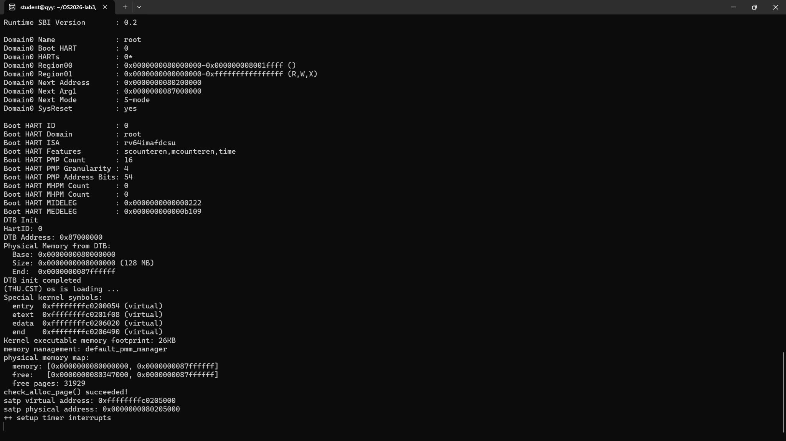
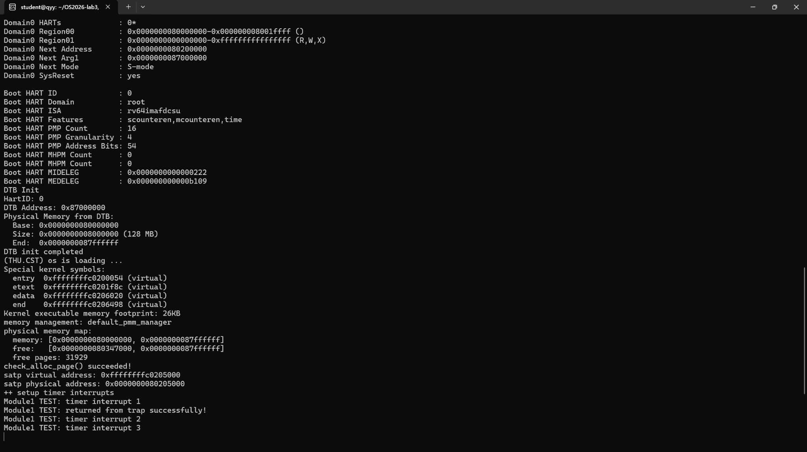

# 操作系统实验报告

## 实验基本信息

| 项目 | 内容 |
|------|------|
| **实验名称** | Lab 3：中断与异常处理 |
| **小组成员** | 2411102-程浩轩、2411112-徐子恩、[胡家华] |


### 小组分工

**练习如何分工？**

| 成员 | 负责的练习/模块 |
|------|----------------|
| 2411102-程浩轩 | 功能模块一：Trap 上下文恢复与 Trap 入口功能（`RESTORE_ALL`、`__alltraps`） |
| 2411112-徐子恩 | 功能模块二：中断处理（`interrupt_handler`） |
| [胡家华] | 功能模块二：异常处理功能


## 一、实验目的

本实验的主要目的是：

1. 理解 RISC-V 中断和异常的基本机制，以及 `stvec`、`sstatus`、`sepc`、`scause` 等寄存器在 Trap 处理过程中的作用。
2. 掌握 Trap 进入内核时处理器上下文的保存和恢复，理解 Trap frame 在汇编入口与 C 语言处理函数之间的传递方式。
3. 完成 Trap 入口、C 语言处理、上下文恢复与 `sret` 返回的基本流程，并通过 QEMU 验证。
4. 在实验过程中使用 AI 辅助理解代码、定位编译和启动问题，同时核对生成代码与实验框架是否一致。

---

## 二、实验环境

- 系统：Windows 11 + WSL2 Ubuntu（实验命令在 Ubuntu 中执行）。
- 目标架构：RISC-V 64 位；使用 `riscv64-unknown-elf` 工具链。
- 模拟环境：QEMU `qemu-system-riscv64`，OpenSBI（运行截图显示 v0.9）。
- 项目目录：Windows `E:\os实验\lab3`，对应 WSL `/mnt/e/os实验/lab3`；源码与 Makefile 位于 `code/`。
- 代码在 Windows 环境检查和编辑；编译与 QEMU 运行通过 WSL Ubuntu-22.04 完成。

**使用的 AI 工具**

| 成员 | AI 编程工具 | 底层模型 | 备注 |
|------|------------|---------|------|
| 2411102-程浩轩 | ChatGPT（聊天界面） | GPT-6 | 辅助分析 Trap 汇编、排查编译及 QEMU 启动问题 |
| 2411112-徐子恩 | Codex | GPT-6 | 核对中断接口、实现 `interrupt_handler()` 并分析编译与 QEMU 结果 |
| [其他成员信息，如有] | [待填写] | [待填写] | [按需要删除] |

---

## 三、实验整体逻辑分析

### 2.1 本章节的逻辑主线

本章的核心是建立操作系统对中断、异常的统一处理流程。发生 Trap 后，处理器根据 `stvec` 转入汇编入口，内核先保存现场，随后把保存的数据以 `struct trapframe *` 传给 C 语言函数 `trap()`。C 语言部分判断是中断还是异常并执行相应处理；处理结束后恢复现场，使用 `sret` 返回原来的执行流程。

两部分模块存在先后依赖关系：模块一提供可靠的“进入和返回”通道，模块二才可以在其中实现时钟中断、非法指令异常和断点异常等具体逻辑。

### 2.2 功能的逐步实现

1. **初始化 Trap 入口**：`idt_init()` 将 `stvec` 设为 `__alltraps` 的地址。
2. **保存上下文**：发生 Trap 后进入 `__alltraps`，执行框架提供的 `SAVE_ALL`，形成 Trap frame。
3. **调用 C 函数**：把当前 `sp` 作为第一个参数传入 `a0`，执行 `jal trap`。
4. **分发和处理**：`trap()` 由 `trap_dispatch()` 将中断交给 `interrupt_handler()`，将异常交给 `exception_handler()`（具体由模块二完成）。
5. **恢复与返回**：跳转 `__trapret`，执行 `RESTORE_ALL` 及 `sret`，恢复原程序执行。

---

## 四、实验内容与实现

### 功能模块一：Trap 上下文恢复与 Trap 入口功能

**负责人：** 2411102-程浩轩

#### 模块功能描述

**需要实现/修改的函数或汇编入口：**

```asm
.macro RESTORE_ALL
    #lab3 function1 YOUR CODE
    # 恢复 Trap 前的寄存器和返回状态
.endm

.globl __alltraps
__alltraps:
    SAVE_ALL
    #lab3 function1 YOUR CODE
    # 调用 trap(struct trapframe *tf)，再进入 __trapret
```

实现文件：`code/kern/trap/trapentry.S`。接口函数是 `void trap(struct trapframe *tf);`，声明位于 `code/kern/trap/trap.h`，定义在 `code/kern/trap/trap.c`。

本模块没有修改框架原有 `SAVE_ALL` 和 `struct trapframe` 的布局。`SAVE_ALL` 在栈上预留 `36 * REGBYTES` 个字节，其中前 32 个位置对应 `pushregs` 的通用寄存器槽位，后四个依次保存 `sstatus`、`sepc`、`sbadaddr`、`scause`。其中原 `sp` 经 `sscratch` 暂存后写入第 2 号槽位。

**`RESTORE_ALL` 的主要实现：**

```asm
.macro RESTORE_ALL
    #lab3 function1 YOUR CODE
    LOAD t0, 32*REGBYTES(sp)
    csrw sstatus, t0
    LOAD t0, 33*REGBYTES(sp)
    csrw sepc, t0

    LOAD x1, 1*REGBYTES(sp)
    LOAD x3, 3*REGBYTES(sp)
    LOAD x4, 4*REGBYTES(sp)
    LOAD x6, 6*REGBYTES(sp)
    LOAD x7, 7*REGBYTES(sp)
    LOAD x8, 8*REGBYTES(sp)
    LOAD x9, 9*REGBYTES(sp)
    LOAD x10, 10*REGBYTES(sp)
    LOAD x11, 11*REGBYTES(sp)
    LOAD x12, 12*REGBYTES(sp)
    LOAD x13, 13*REGBYTES(sp)
    LOAD x14, 14*REGBYTES(sp)
    LOAD x15, 15*REGBYTES(sp)
    LOAD x16, 16*REGBYTES(sp)
    LOAD x17, 17*REGBYTES(sp)
    LOAD x18, 18*REGBYTES(sp)
    LOAD x19, 19*REGBYTES(sp)
    LOAD x20, 20*REGBYTES(sp)
    LOAD x21, 21*REGBYTES(sp)
    LOAD x22, 22*REGBYTES(sp)
    LOAD x23, 23*REGBYTES(sp)
    LOAD x24, 24*REGBYTES(sp)
    LOAD x25, 25*REGBYTES(sp)
    LOAD x26, 26*REGBYTES(sp)
    LOAD x27, 27*REGBYTES(sp)
    LOAD x28, 28*REGBYTES(sp)
    LOAD x29, 29*REGBYTES(sp)
    LOAD x30, 30*REGBYTES(sp)
    LOAD x31, 31*REGBYTES(sp)
    LOAD x5, 5*REGBYTES(sp)
    LOAD x2, 2*REGBYTES(sp)
.endm
```

这段代码先从 Trap frame 恢复 `sstatus` 和 `sepc`，然后恢复通用寄存器。`x5`（即 `t0`）被临时用于写 CSR，因此在最后才从栈中恢复；`x2` 就是栈指针 `sp`，必须最后恢复，否则后续寄存器加载就可能使用错误的栈基址。`x0` 恒为零，无需恢复；`scause` 与 `sbadaddr` 是陷入时的诊断信息，不属于这次 `sret` 必须恢复的状态。

**`__alltraps` 的主要实现：**

```asm
.globl __alltraps
.align(2)
__alltraps:
    SAVE_ALL
    #lab3 function1 YOUR CODE
    mv a0, sp
    jal trap
    j __trapret

.globl __trapret
__trapret:
    RESTORE_ALL
    sret
```

其中 `mv a0, sp` 利用 RISC-V 调用约定将 Trap frame 首地址作为第一个参数交给 `trap()`；`jal trap` 进入 C 函数；返回后跳转 `__trapret`，由恢复宏和 `sret` 完成返回。`SAVE_ALL` 产生的 288 字节栈帧在 RV64 上满足调用前的栈对齐要求（前提是 Trap 入口原 `sp` 已按内核约定对齐）。

模块一的 Spec 以现有 `SAVE_ALL` 和 `struct trapframe` 为约束：恢复偏移必须逐项对应，`x0` 不需恢复，暂用的 `t0` 和原 `sp` 应最后恢复；`sstatus`、`sepc` 写回后由 `sret` 完成返回，不改变模块二接口。面向 AI 的 Prompt 先提供 `trapentry.S`、`trap.h`、`trap.c` 及 `riscv.h` 的真实定义，再要求核对寄存器槽位、调用约定和栈对齐，并把汇编检查、链接与 QEMU 运行分别验证。这一设计避免只凭函数名或未经核对的偏移生成恢复代码。

本模块经历了代码实现、工程依赖修复和运行验证三个阶段。下面只记录实际对话中发生过的操作和现象。

**实施过程：** 查看 `trapentry.S`、`trap.h`、`trap.c`，发现框架已提供 `SAVE_ALL`，但 `RESTORE_ALL` 和 `__alltraps` 仍留有 `#lab3 function1 YOUR CODE`。依据寄存器保存位置实现恢复代码，并在 `__alltraps` 中加入 `mv a0, sp`、`jal trap` 和 `j __trapret`。

**初步结果：** `make -k` 输出中出现 `+ cc kern/trap/trapentry.S`，该汇编文件未报错，说明通过汇编检查；但整个项目尚未成功链接，不能据此认定运行正确。

**遇到的问题及处理：**

1. `trap.c` 调用 `interrupt_handler`、`exception_handler` 时出现隐式声明错误。为独立测试模块一，临时加入函数声明和测试桩；组员二后续应替换为正式实现。
2. `best_fit_pmm.c` 缺少 `free_list`、`nr_free`。检查发现 `pmm.c` 选择的是 `default_pmm_manager`，因此仅在 Makefile 源文件列表中暂时过滤不使用的 Best Fit 文件。
3. `pmm.c` 调用 `page_init()` 但原 Lab3 框架未提供对应实现。从已完成的 Lab2 工程提取该函数，并针对缺少的 `PHYSICAL_MEMORY_END`、`KERNEL_BEGIN_PADDR` 补充与已有 Lab2 工程一致的内存布局宏。
4. 首次运行 QEMU 只显示 OpenSBI，没有显示内核日志。检查 Makefile 后，将 `qemu` 目标中的 `-device loader,file=$(UCOREIMG),addr=0x80200000` 改为 `-kernel $(UCOREIMG)`，此后进入内核并看到 `check_alloc_page() succeeded!`、`++ setup timer interrupts`。

以上是为了恢复 Lab3 可测试环境而进行的依赖调整，**不是模块一的主要功能实现**；最终合并时应由小组共同审核其保留方式。

**测试方法：** 在临时 `trap_test_stub.c` 中收到时钟中断后调用 `clock_set_next_event()` 安排下一次中断，同时累加 `ticks` 并打印前三次中断。测试版 `kern_init()` 在正常执行循环中检查中断处理时设定的 `trap_test_seen` 标记，打印返回成功信息。这个标记是在 Trap 外部的正常执行流中观察到的，比单纯在中断处理函数内部打印更能说明 Trap 返回成功。

**实际运行输出：**

```text
++ setup timer interrupts
Module1 TEST: timer interrupt 1
Module1 TEST: returned from trap successfully!
Module1 TEST: timer interrupt 2
Module1 TEST: timer interrupt 3
```

**结果分析：** 编译、链接、QEMU 启动均成功；临时测试中能重复进入时钟中断处理函数，且在正常执行流中打印返回成功信息，支持模块一的 Trap 入口、保存、C 函数调用、恢复和 `sret` 返回路径通过基本运行测试。此测试并未逐项检查所有通用寄存器的数值一致性，也不等于模块二全部功能通过。

**关键改进点总结：**

1. 先用 `SAVE_ALL` 和 `struct trapframe` 交叉核对保存槽位，再写 `RESTORE_ALL`，避免自行猜测偏移。
2. 把内核依赖错误和模块一本身错误区分开，逐步修复链接、内存管理和启动参数。
3. 使用临时函数完成独立验证，测试完成后将其移出正式编译目录，避免与组员二实现冲突。

---

### 功能模块二：中断处理

**负责人：** 2411112-徐子恩

本模块只实现 `code/kern/trap/trap.c` 中的 `interrupt_handler(struct trapframe *tf)`。胡家华负责的 `exception_handler()` 属于异常处理模块，当前尚未合并，因此本节不描述其实现或声称异常路径已通过测试。Trap 入口保存现场后调用 `trap()`；`trap_dispatch()` 将 `tf->cause` 转为有符号整数，利用最高位区分中断与同步异常，再把中断交给本函数。处理结束后沿队友一的 `__trapret` 路径恢复现场。

本练习的 Spec 是持续响应 Supervisor Timer Interrupt：每次重设下一事件，`ticks` 恰好加一，每 100 次输出一次框架规定的 `100 ticks`，累计输出 10 次后通过 SBI 关机；其他已定义 IRQ 应有明确日志，未知 IRQ 应打印完整 Trap frame。Prompt 设计先要求 AI 搜索 `clock_set_next_event()`、`ticks`、`TICK_NUM`、IRQ 宏、`sbi_shutdown()` 及 `trap_dispatch()` 的实际定义，再限制修改范围和验证结论。检查发现仓库没有 `SHUTDOWN_AFTER`，于是只在 `trap.c` 补充 `#define SHUTDOWN_AFTER 10`，并包含已有的 `sbi.h`；没有新建重复的 tick 全局变量。

核心函数按实际执行路径分为以下三段展示。三段代码按顺序连接，即为当前源码中的完整 `interrupt_handler()`，这里仅为便于说明而分开展示。

**原因解析与时钟中断。** `tf->cause` 是 64 位 `uintptr_t`；`scause` 的最高位表示中断，低位才是原因编号。因此先清除第 63 位，再与 `IRQ_S_TIMER` 比较。每次收到时钟中断，先设置下一次事件，再将全局 `ticks` 加一；`print_ticks()` 只在 100 的整数倍调用。`printed_count` 仅在输出后增加，因此第 10 次输出恰好发生于第 1000 次 tick，随后调用 SBI 关机接口。

```c
void interrupt_handler(struct trapframe *tf) {
    uintptr_t irq = tf->cause & (((uintptr_t)1 << 63) - 1);
    static size_t printed_count = 0;

    switch (irq) {
    case IRQ_S_TIMER:
        clock_set_next_event();
        ticks++;
        if (ticks % TICK_NUM == 0) {
            print_ticks();
            printed_count++;
            if (printed_count >= SHUTDOWN_AFTER) {
                sbi_shutdown();
            }
        }
        break;
```

**其他已定义的中断。** 其余 IRQ 按 `riscv.h` 中已有的类型分别输出日志。这里不引入新的 IRQ 宏，也不改变时钟计数。

```c
    case IRQ_U_SOFT:
        cprintf("User software interrupt\n");
        break;
    case IRQ_S_SOFT:
        cprintf("Supervisor software interrupt\n");
        break;
    case IRQ_H_SOFT:
        cprintf("Hypervisor software interrupt\n");
        break;
    case IRQ_M_SOFT:
        cprintf("Machine software interrupt\n");
        break;
    case IRQ_U_TIMER:
        cprintf("User timer interrupt\n");
        break;
    case IRQ_H_TIMER:
        cprintf("Hypervisor timer interrupt\n");
        break;
    case IRQ_M_TIMER:
        cprintf("Machine timer interrupt\n");
        break;
    case IRQ_U_EXT:
        cprintf("User external interrupt\n");
        break;
    case IRQ_S_EXT:
        cprintf("Supervisor external interrupt\n");
        break;
    case IRQ_H_EXT:
        cprintf("Hypervisor external interrupt\n");
        break;
    case IRQ_M_EXT:
        cprintf("Machine external interrupt\n");
        break;
    case IRQ_COP:
        cprintf("Coprocessor interrupt\n");
        break;
    case IRQ_HOST:
        cprintf("Host interrupt\n");
        break;
```

**未知中断。** 对未匹配的原因先输出编号，再用 `print_trapframe(tf)` 输出现场，避免静默忽略。末尾关闭 `switch` 和函数。

```c
    default:
        cprintf("Unknown interrupt: cause %d\n", (int)irq);
        print_trapframe(tf);
        break;
    }
}
```

AI 辅助实现中最关键的两个问题是原因编码和验证边界。最初若仅按 IRQ 宏值判断，会忽略 `scause` 的中断位；对照 `trap_dispatch()` 和 `riscv.h` 后改为掩去最高位。正式 `make` 又在链接时报告 `undefined reference to exception_handler`，但 `trap.c` 和 `trapentry.S` 已完成编译；该符号属于尚未合并的异常模块，不能为消除报错而改写队友代码。为验证本模块，仅在 WSL `/tmp` 编译临时异常处理桩并独立链接测试镜像，仓库源码没有加入测试桩。

---

## 五、测试与验证

### 5.1 模块一：内核启动与内存初始化

执行 `make clean`、`make` 和 `make qemu` 后，QEMU 输出内核初始化日志，可观察到 `memory management: default_pmm_manager`、`check_alloc_page() succeeded!` 及 `++ setup timer interrupts`。这证明测试环境可启动内核并执行到时钟初始化位置。



### 5.2 模块一：时钟 Trap 进入与返回

使用临时测试函数，实际观察到第一次时钟中断、返回原执行流后的确认输出，以及第二、第三次时钟中断。截图如下：



**结论：** 模块一已通过基础运行测试；尚未进行逐寄存器恢复值检查。临时测试处理函数只用于模块一验证，不计入组员二的正式实现。

### 5.3 中断处理模块与整组联合验证

在 WSL Ubuntu-22.04 的 `code/` 目录执行 `make`，`trap.c` 与 `trapentry.S` 均编译通过；正式链接停在 `undefined reference to exception_handler`。这说明当前中断模块没有 C 语法或宏定义错误，但由于异常处理尚未合并，不能称整组内核已完成构建。

为隔离该依赖，仅在 WSL `/tmp` 中编译临时异常处理桩，按项目入口对象顺序独立链接并以 QEMU 启动测试镜像。内核输出 `++ setup timer interrupts`，随后连续出现 10 次 `100 ticks`，进程正常退出，表明该测试条件下时钟事件能够重复设置，Trap 能够多次返回，且达到预设输出次数后调用了关机接口。临时桩不属于正式代码，测试也不覆盖异常处理路径或全部寄存器值的逐项校验。正式 `make qemu` 和 `make grade` 尚未在完整团队代码上通过，需待 `exception_handler()` 合并后再进行联合验证。

---

## 六、实验总结与收获

### 对操作系统的理解

**模块一已完成部分：**

1. **Trap 与处理器上下文。** Trap 并非简单调用普通函数：硬件改变异常返回相关状态，内核还必须保存软件可见寄存器，才能在处理后恢复原执行流。
2. **Trap frame 与栈帧。** 本实验的 Trap frame 是特定布局的保存区，汇编中的偏移要与 C 语言 `struct trapframe` 字段顺序一致；普通 C 函数调用也使用栈，但两者的用途和保存约定不同。
3. **控制状态寄存器与返回。** `sepc` 指示返回执行位置，`sstatus` 保存返回所需的特权相关状态，`sret` 完成特权态陷入返回。`scause`、`sbadaddr` 则主要用于判断和诊断异常原因。
4. **中断与异常的分工。** 模块一负责通用进入/返回，模块二决定怎样处理具体原因。这样可以避免每种异常重复编写保存和恢复流程。
5. **理论中重要、但本实验暂未完整涉及的内容。** 例如用户态与内核态完整切换、多核中断路由、复杂设备中断优先级和抢占式调度，都需要更完整的内核机制支持。

**中断处理的进一步理解：** 中断通常由外部事件异步触发，时钟处理完毕后应返回被打断的指令流；同步异常由当前指令触发，是否调整 `epc` 取决于异常类型和处理策略，属于后续异常模块。Trap frame 保存的是进入处理程序时的现场，`ticks` 则是内核维护的时钟事件计数，二者用途不同。定时器重新编程与中断使能共同决定时钟是否能持续触发；本实验使用单核、单一时钟事件，没有实现进程调度、多核中断分发、设备中断优先级或用户态上下文切换，这些机制还需要在现有 Trap 通路之上扩展。

### AI 协作开发的经验

本次实验中，我主要利用 AI 辅助阅读 `SAVE_ALL` 和 `struct trapframe` 的对应关系，并逐步定位编译、链接、QEMU 启动等问题。比较有帮助的做法是每次先提供真实的文件内容和终端报错，再针对单个问题修改，而不是直接替换整个工程。特别是在模块二尚未完成时，使用临时测试桩隔离问题，可以先验证模块一的基本流程。不过 AI 给出的汇编和工程修改仍需要与真实代码核对，不能只根据“编译成功”判断正确，还必须观察运行输出。

徐子恩在实现中断模块时先让 AI 对照真实源码寻找接口和常量，再核查 `scause` 的最高位语义及计数边界。对编译通过、链接失败和临时桩下 QEMU 运行成功分别记录，避免将局部验证写成完整实验通过。待异常处理模块合并后，小组仍需完成正式内核的联合测试。
